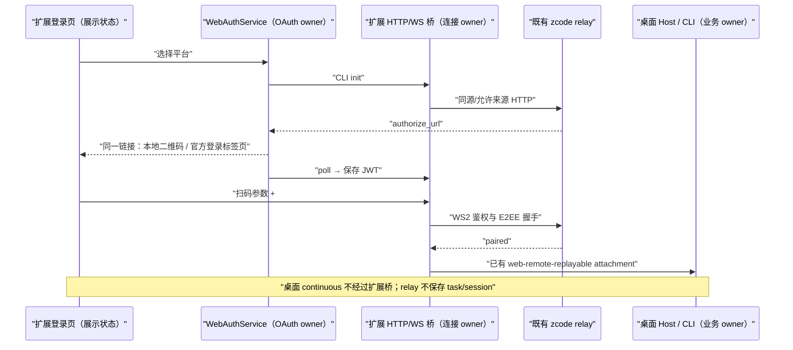

# 浏览器扩展登录与中转连接

## 状态与范围

本规格补充[端到端加密](./end-to-end-encryption.md)与 [Web Remote Login](./web-remote-login.md)，覆盖本地安装的浏览器扩展在 Chrome/Edge 和 iPadOS Orion 等浏览器中的登录、一次性 relay token 与首条 WebSocket 连接。桌面二维码仍指向 `https://kingingwang.github.io/Codez/remote/v4/`，并保留 `sid` 与 `#e2ee`；不部署新服务器，不执行 `zcode.z.ai` 页面的远端脚本。Android 原生桥与桌面 `desktop-continuous` 不变。

线上可确认的事实：`wss://zcode.z.ai/api/v1/remote/ws2` 用扩展 Origin 握手返回 403，用 `https://zcode.z.ai` Origin 携无效诊断 token 则返回 401。前者未通过来源检查，后者已进入 token 校验。Orion iPadOS 的 WebExtension API 仍属实验性支持；Chrome 测试不能代替 Orion 真机验收。用户报告的“第 1 步连接中转服务→正在重连”尚不足以区分 token HTTP 与 WebSocket 握手，以下回归同时覆盖两者。

## 产品规则、所有者与接口

1. 扩展页面 HTML/JS/CSS 由本地安装包提供。OAuth 扩展入口使用后端 CLI polling：选择平台后，先留在扩展页，使用 `init` 返回的同一官方 `authorize_url` 本地生成无需 Canvas 的 SVG 可扫码二维码；用户显式选择“在此设备登录”时才在新标签页打开该链接。第三方授权页自己的二维码缺失不得阻止这两个入口；授权完成或本次 flow 失败时关闭本次打开的标签页。授权链接不得包含桌面配对密钥、JWT 或 poll token；二维码生成不得下载远端可执行脚本。
2. `WebAuthService` 是 OAuth flow 与凭据写入的唯一 owner；登录页只持有当前展示的授权链接与二维码图像。`WebRemoteControlEntry` 保留原始扫码参数、`#e2ee`、账号门禁与连接准入，不复制认证状态。CLI 初始化或轮询失败时显示可重试的登录错误，不静默退回此前在 Orion 上出现 CSRF/500 的网页回调链。
3. `resolveWebRemoteControlFetcher` 是扩展 HTTP 出站适配边界：扩展 runtime 的 callback 或 Promise 中，只有具有合法 `status/body` 的结果才算响应；`Promise<void>` 提前完成不是 HTTP 结果。调用取消或有界等待到期后释放监听。扩展桥未交付结果时明确失败，不能静默退回注定被 Origin/CORS 拒绝的页面 `fetch`。
4. `CodezExtensionWebSocket` 是扩展 socket 状态 owner，原生握手在 `OPEN` 前失败才启用 `zcode.z.ai/robots.txt` 隔离 content script 同源桥。`robots.txt` 是静态纯文本，不执行该域网页 JS。普通远控网页与 OAuth 回调页只负责跳转，不可通过 `window.postMessage` 驱动后台 HTTP/WS 特权操作。扩展同时暴露 `chrome.runtime` 与 `browser.runtime` 时，WS 消息通道优先采用同时具备 `sendMessage` 与 `onMessage.addListener` 的一套 API，不把只具备发送能力误判为双向桥。iframe 地址不携带一次性 WS token；只有收到桥就绪消息后，本地扩展页才发送打开命令，content script 必须核对父页面的扩展 origin 与 `event.source`，拒绝其他网页、空 origin 与自动打开。桥接通道只能访问规定的 relay/API 目标；iframe 桥的每个密文事件只沿父页面通道投递一次，独立标签页桥只沿 runtime 通道投递一次。旧页面与新页面的 socket ID 必须隔离，重复/迟到事件不能打开新 socket。background tab 的存在不等于 content script 已就绪，发消息前须收到桥接确认；桥不可用时显式终止首次连接，不能无限展示“正在重连”。
5. `WebRemoteControlTerminalTransport` 负责 relay token、WebSocket、鉴权与重试；首次连接超过有界期限仍未进入配对时给出可重试的 `relay-unavailable` 及安全诊断码。已配对后的短断线继续走既有自动恢复与 `web-remote-replayable` attachment，不受首次期限影响。错误、日志、诊断不得包含 JWT、一次性 token、完整二维码链接、密钥或业务帧。

## Impact Brief

| 字段           | 内容                                                                                                                                                                                     |
| -------------- | ---------------------------------------------------------------------------------------------------------------------------------------------------------------------------------------- |
| 能力与层级     | 浏览器扩展远控；`presentation`（本地授权二维码）、`validation`（桥回执）、`commit-effect`（连接）、`recovery`（首连失败/已配对恢复）                                                     |
| UI surface     | 扩展登录页、本地远控连接进度/失败页、桌面二维码弹窗；Android App 与未安装扩展的普通浏览器是隔离回归面                                                                                    |
| 共享实现与差异 | Web 与 Android 共享入口参数、Relay V2、E2EE 和 Host attachment；只有扩展使用 runtime/content-script 桥，Android 使用原生桥，桌面仍走 continuous                                          |
| 状态与落点     | 登录页仅展示 URL/QR；`WebAuthService` 持凭据；`WebRemoteControlEntry` 持连接 admission；terminal transport 持 socket/generation；Desktop Host/CLI 持任务与 replayable 恢复               |
| 上下游优先级   | must-inspect：扩展打包脚本、HTTP fetcher、WebSocket 适配、terminal transport；should-inspect：OAuth 登录页、QR URL 保留；invariant-only：Android 原生桥、未安装扩展拦截、桌面 continuous |
| 代码事实       | 当前环境没有 `codegraph` 命令；按功能图种子与现有导入/测试定位。图谱原本仅有 `capability.remote-delivery` 和桌面 QR surface，浏览器扩展登录/桥接是 drift candidate                       |
| 未决条件       | Orion 真机是否向 `robots.txt` 注入 content script、是否允许其在隐藏 iframe/后台 tab 持续使用 WebSocket，必须实机复测；单测与 Chrome 不能证明                                             |

## 验收场景

| ID     | 环境与动作                                                                | 断言                                                                               |
| ------ | ------------------------------------------------------------------------- | ---------------------------------------------------------------------------------- |
| EXT-01 | runtime Promise 先返回 `undefined`，callback 稍后返回有效 token HTTP 响应 | 采用 callback 结果，不发页面跨域 `fetch`，不误判失败                               |
| EXT-02 | 扩展 HTTP 桥无响应、拒绝或请求取消                                        | 结束本次请求；无直接页面 `fetch` 兜底；首连显示安全的可重试原因                    |
| EXT-03 | 原生 WS 在 `OPEN` 前失败，静态同源桥就绪                                  | 只采用当前代际的桥事件；重新扫码/刷新后的 socket ID 不复用旧桥连接                 |
| EXT-04 | 静态桥无法就绪或 WS 始终不能配对                                          | 有界首次连接后进入失败页并显示安全诊断码；不再永远停在第 1 步                      |
| EXT-05 | Orion 第三方授权页二维码空白，用户在扩展页选择平台                        | 扩展先停留在本地二维码页；显式点击同机登录才打开官方页；不丢 `sid/#e2ee`           |
| EXT-06 | Android App、Chrome/Edge 桌面扩展、普通未安装扩展浏览器                   | 原生桥、DNR 快路径、未安装提示分别保持原行为                                       |
| EXT-07 | 任意网页嵌入 `robots.txt` 并尝试发连接命令或在 iframe fragment 注入 URL   | 不开 WS、不提供 HTTP 特权；扩展父页面的就绪→打开命令继续可用，URL 不含一次性 token |
| EXT-08 | Orion 的 `chrome.runtime` 只可发送而 `browser.runtime` 具备双向消息 API   | 首次桥接采用 `browser.runtime` 发/收同一通道，不因缺少 `onMessage` 卡在第 1 步     |

测试：扩展打包/消息适配的 Node/Vitest 单测，OAuth 服务与登录页单测，Chrome for Testing 实扩展及窄屏浏览器回归，最后由 Orion iPadOS 和手机真机分别验证登录、token、WS `open/auth_ack`、E2EE 配对及任务首页。真实设备未跑通前不得宣称 EXT-03/04 在 Orion 已验收。
