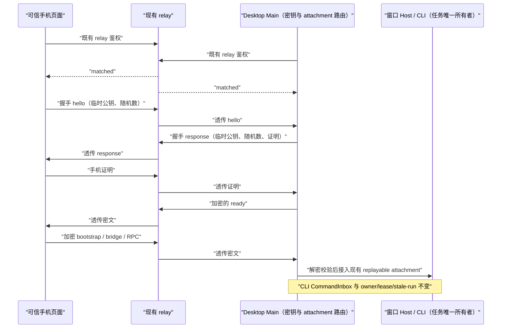

# 手机远控端到端加密

## 产品规则与威胁模型

- 手机继续扫码进入远控；现有 relay 仅负责注册、配对、心跳及 `data.payload` 透传，不修改其服务端协议或业务代码。
- Relay V2 下桌面与手机分别用同一智谱账号 JWT 申请一次性 token 并连接 `/api/v1/remote/ws2`。Relay 仅做配对与透传，不能用作内容加密密钥。桌面另用 CSPRNG 产生 32 字节 `K_pair`，只存 credential service，并置于二维码 URL 的 `#e2ee=v1&k=<base64url>`。URL query 携带 V2 所需的 `sid/mid/name/app_version`。
- 远控前端代码必须由与 relay 分开管理的可信来源提供，且**仅允许在受信任客户端环境（Codez Android App 或本地安装的 Codez 浏览器扩展）内运行**：
  - Android App 环境：前端 HTML/JS/CSS 随 APK 内置在本地 `assets/remote/v4/`，由 WebView 通过虚拟 HTTPS 域名 `https://appassets.androidplatform.net/Codez/remote/v4/` 从本地读取，不从 `kingingwang.github.io` 或 `zcode.z.ai` 下载可执行脚本；网络请求通过 `window.CodezAndroidSocket` 原生桥代发无 `Origin` 的 HTTP/WebSocket 请求；
  - 浏览器扩展环境（Chrome / Edge / Firefox / Orion 等扩展）：前端 HTML/JS/CSS 全部随扩展安装包保存在本地，不从 `zcode.z.ai` 下载可执行脚本；扩展通过 `declarativeNetRequest` 自动将发往 `https://zcode.z.ai/api/v1/*` 的 HTTP 与 WebSocket 请求 `Origin` 改写为 `https://zcode.z.ai`：
    - OAuth 登录优先采用 `/api/v1/oauth/cli/init` 与 `/api/v1/oauth/cli/poll/:flowId` 轮询授权模式（授权页回调直接进入 `/api/v1/oauth/cli/callback/:provider`，不经过 `https://zcode.z.ai/remote/v4` 页面），彻底规避移动端/iPad 浏览器（如 Orion）在跨源跳转时阻断 `*-extension://` 重定向或让 `zcode.z.ai` 页面脚本抢先消费一次性 `authCode` 导致 `HTTP 500 (code 2007)` 及跨源 `localStorage` 隔离导致 `OAuth CSRF 检测失败` 的问题；
    - 当移动端扩展（如 iPad Orion）不支持 `declarativeNetRequest` 修改 WebSocket 握手 `Origin` 头导致直连 `wss://zcode.z.ai/api/v1/remote/ws2` 失败时，尝试由 `https://zcode.z.ai/robots.txt` 静态纯文本资源中的隔离 Content Script 建立同源桥；桥接必须确认就绪并在首次连接失败时给出明确错误。Orion 对 WebExtension API 的支持仍是实验性的，构建通过不等于真机已可用，验收见[浏览器扩展登录与中转连接](./browser-extension-connectivity.md)；
  - 未安装扩展的普通手机/桌面浏览器直接访问 `https://kingingwang.github.io/Codez/remote/v4/` 时，立即拦截并提示用户使用 Codez 手机 App 或安装 Codez 浏览器扩展。
    默认二维码入口继续固定为 `https://kingingwang.github.io/Codez/remote/v4/`；仓库维护者控制页面源码、Pages 发布及扩展构建产物，智普 relay 不控制前端脚本。桌面允许本地显式 `CODEZ_WEB_REMOTE_CONTROL_E2EE_URL` 覆盖默认入口，但不接受 relay 响应或 endpoint 配置指向的页面；桌面发行代码及仓库发布权限均属于可信边界。
- relay 可观察配对凭据、IP、设备元信息、连接时间、帧大小与握手公钥，但不可取得 `K_pair`、会话密钥或业务明文；主动改写、注入、重排、重放和降级业务帧均须在桌面/手机端拒绝。
- 旧手机页面及缺少合法 `K_pair` 的旧链接不能控制新版桌面；升级时旧 relay 配对一并轮换。缺少可信站点发布配置、站点证书无效、relay 拒绝该站点 WebSocket Origin 或服务端不透传新的 opaque payload 时，不得回退到明文。
- 手机网页只从可信站点加载可执行代码；不引入 relay 所在 origin 的脚本。远控入口不将完整 URL、fragment、密钥、明文 payload 写入日志、遥测、OAuth state、网络请求或第三方资源 URL。浏览器重新加载仍可从原 fragment 恢复密钥。

## 唯一所有者、接口与时序

- Desktop Main 持有安装/窗口级 `K_pair`、当前加密连接及已有 bridge 路由；credential service 是 `K_pair` 的唯一持久化落点，AppSettings 只存非敏感 `deviceSid`。桌面发行配置决定可信页面默认 URL，本地开发可显式覆盖，relay 只提供 WebSocket endpoint，不能改页面 URL。
- 手机 transport 持有当前页面的配对密钥和短生命周期加密连接；UI 仅显示就绪/错误投影。共享 client 模块提供无状态密码学原语和连接级加密适配；shared 模块声明二维码参数和严格的握手/密文 wire schema。
- relay 的 `matched` 只允许开始端到端握手。手机发送版本、`deviceSid`、新鲜临时 X25519 公钥及随机数；桌面回复自己的公钥和随机数，以及绑定双方 transcript 和角色的 `K_pair` HMAC；手机校验并回传自己的证明。桌面校验后发送经会话密钥认证的就绪记录，手机收到后才发 bootstrap。握手有界超时，任一步失败都关闭业务入口。"关闭业务入口"指握手完成前不 attach Host、不接受业务帧，而不是永久终止传输：握手证明失败、握手超时或握手消息发送失败时，两端各自废弃当前临时密钥并沿既有 socket 重建与抖动重连路径重试握手，桌面在重建命中 `matched` 后照旧发送 `e2ee-rekey`；重试不设次数上限，单次损坏帧不得使整段远控连接进入终态。跨轮次的旧记录仍一律丢弃且不触发重连。
- 双端使用 HKDF-SHA-256 混合临时 X25519 shared secret 与 `K_pair`，以完整握手 transcript 作上下文，派生方向独立的 XChaCha20-Poly1305 密钥、nonce 前缀和轮次 ID。临时私钥在派生后丢弃；版本、方向、轮次、`deviceSid`、单调序号均进入 AEAD AAD。
- `data.payload` 除握手和加密记录外不接受任何业务消息。加密记录的明文是现有上游 `zcode_type` 业务 payload；解密、鉴权和重放检查完成后，才允许旧的 wire 归一、strict schema、raw frame/ACK 快捷路径及 workspace 路由。握手前不得 attach Host。
- 同一轮次每方向使用单调 nonce/record 序号；相同序号仅允许字节完全一致的已认证 RPC frame 重发，并交给既有 acknowledged adapter 去重与补 ACK；其他重复业务记录不再投递。跨轮次的旧记录一律丢弃。密文与最终 relay JSON 在首次计量时固定，重发原样使用缓存，不重新加密或刷新排队年龄。
- 配对从 `matched` 离开、peer 换代、socket 重建或显式停止时废弃会话密钥、短期 buffer 和旧 bridge；重新握手后通过同一个 `web-remote-replayable` attachment 的 snapshot/gap 及 `commands/query` 恢复，不自动重发 ACK 不明的变更。桌面 `desktop-continuous` 仍走原直接连接。
- 正常切项目不重置加密连接；bridge 故障先复用已就绪 transport。真正 E2EE reset 时同时失效旧 bridge admission（包含已完成 promise），取消在途项目准备；同一旧 identity 不得复活已释放 attachment。手机重开时使用新 `bridgeSessionId + bridgeGeneration`，只在同加密会话内复用 admission 去重身份，不跨加密轮次直接重放旧 bridge-open。
- Desktop socket 换代而手机仍保持同一 socket 时，Desktop 发送不带业务授权的 `e2ee-rekey` 提醒手机重建临时密钥；同一 Desktop socket 收到新手机的 hello 时也先废弃旧 bridge/密钥，且 hello 在任意握手阶段（含上一轮换未完成时）到达都同样废弃旧会话重新开始。relay 可伪造提醒造成拒绝服务，但不能完成证明或得到业务访问权。

## 实现与兼容边界

- GitHub Actions 默认从受信任的 `main` 分支构建 `CODEZ_ENV=production` 的 Web bundle；初次实机验收可由仓库管理员手动从隔离功能分支触发相同工作流发布手机页，不能因此自动发布桌面安装包。Vite 资源 base 为 `/Codez/remote/v4/`，把 `index.html` 和资源发布到 Pages 站点的 `remote/v4/` 目录。扫码入口固定为 `https://kingingwang.github.io/Codez/remote/v4/`，桌面默认使用该入口；手机刷新和桌面版本校验保留 URL query 与 `#e2ee`。Pages 自动提供浏览器信任的 HTTPS 证书，无须用户申请 CA 证书。生产可由可信桌面本地环境显式覆盖 HTTPS 页面，旧 `CODEZ_WEB_REMOTE_CONTROL_URL` 仅在非打包开发有效；本地 HTTP loopback 仅用于开发，不作为生产安全证据。
- 发布顺序：先在 GitHub 仓库设置中选择 GitHub Actions 作为 Pages 来源并部署站点，实际确认带 query/fragment 的入口及静态资源可访问，再发布指向该默认入口的桌面版本。若站点尚未就绪，二维码即使生成也不可宣布可用；不得自动转到 relay 托管的旧页面或明文。页面上的 relay WebSocket 仍指向现有智普 `wss://` endpoint；Pages 并不充当 relay。
- 沿用二维码生成、配对凭据存储、payload serializer 和 acknowledged RPC adapter，不建立第二套任务或重放 owner。同步跨端加密组件避免 WebCrypto 异步操作破坏现有同步 `sendFrame/measureFrameBytes` 合同；精确调整物理分片预算，保持最终 relay JSON 的 1 MiB、单 logical message 的 16 MiB/64 片和 buffer/45 秒边界。
- 所有手机业务包（bootstrap、workspace list、view state、diagnostic、telemetry、platform、RPC frame 与 ACK、degraded/error）使用同一加密路径；异常日志仅写安全的 reason code，不泄露 URL 或 payload。断开前可发送的错误仍需加密，无法加密时仅在本地显示状态。
- 现有本地及 SSH/WSL/Docker workspace 使用同一 Host；bridge 仍以 `workspaceIdentity?.trim() || workspacePath` 隔离，远程路由继续绑定 `remoteSessionId`，不为手机另起 Agent/Host。

## 应用层压缩（relay-gzip）

E2EE 先加密后上 relay WebSocket，密文近乎随机，WebSocket permessage-deflate 即使协商成功也压不动；桌面→手机方向的大 payload（会话快照、workspace-list、rpc-frame）只能按明文体积传输，手机表现为持续数百 KB/s 甚至 MB/s 的异常流量。因此在 E2EE 之内增加应用层「先压缩后加密」：

- 发送方把内部 app payload JSON gzip 后包进 `relay-gzip` 信封（`{ codez_type: "relay-gzip", v: 1, data: base64(gzip(json)) }`），信封作为普通 app payload 走既有 seal/序列化/ACK/重发管线；接收方在 strict schema 校验归一前拦截信封，gunzip 还原后继续原有路由。信封还原失败按畸形帧静默丢弃，不进入业务路由。
- 版本协商：握手 schema 全部 `.strict()` 不能加字段，因此用 app 级 `client-capabilities` 消息（`{ codez_type: "client-capabilities", v: 1, caps: [...] }`）宣告解码能力。旧版本对未知 `codez_type` 一律静默丢弃，新消息对旧端安全。两端在 E2EE ready 后各宣告一次；发送方仅在收到对端宣告 `relay-gzip.v1` 后才发送信封。新手机+旧桌面、旧手机+新桌面都退化为不压缩的现状。手机端仅在浏览器支持 `DecompressionStream("gzip")`（Safari 16.4+）时宣告，否则桌面保持明文发送。
- 小于 1 KiB 的 JSON 不值得压缩（gzip 头尾开销），保持原样发送。压缩只用于桌面→手机下行大 payload；手机上行都是小 payload，不压缩。
- 密文与最终 relay JSON 仍在首次计量时固定：gzip 信封在 seal 前生成并随明文一起缓存，ACK 重发复用同一字节，不重新压缩或重新加密。
- 接收方在解密、鉴权、重放检查完成后才识别信封；gzip 还原后的内容重新走原有的 wire 归一与 strict schema 校验，压缩不改变任何业务消息的 schema 与路由。
- 桌面主进程按 60 秒窗口聚合设备到终端下行字节与帧数（`[web-remote-control] relay traffic` info 日志），用于观测压缩收益与异常流量回归；日志只含字节数、帧数与压缩比例，不含 payload 内容。
- 流量计量必须区分 logical app JSON bytes、外层 relay JSON bytes、frame count、gzip frame
  count 与 capability 状态；按 socket generation 清零，不能把重连前后的数据合并。

## 验收用例

| ID      | Setup → Action                                         | 断言与证据                                                                                                                                                                                    |
| ------- | ------------------------------------------------------ | --------------------------------------------------------------------------------------------------------------------------------------------------------------------------------------------- |
| E2EE-00 | 双端支持 relay-gzip 的新配对会话                       | ready 后互收 `client-capabilities`；下行大 payload 以信封传输且字节显著下降（实测同 88 条消息 rpc-frame 505KB→129KB）；还原后路由与明文路径一致。transport 端到端测试 + 真实 relay 流量日志。 |
| E2EE-01 | 新配对 → 扫码进入可信站点                              | HTTP、relay 和日志不含 `K_pair`；鉴权后双向证明成功；加密 bootstrap、首页、任务发送与回复来自现有 Host。浏览器网络和 Host/CLI 证据。                                                          |
| E2EE-02 | 中间 relay 修改握手、密文、AEAD 头，或注入明文         | 两端 fail closed，零 workspace attach/CLI command；错误不含敏感数据。传输与 Host spy 测试。                                                                                                   |
| E2EE-03 | 重发同一帧/ACK、重排或回放旧轮次密文                   | RPC 只由现有 adapter 去重/补 ACK；命令最多 admission 一次，旧轮次无副作用。确定性 transport/CLI 测试。                                                                                        |
| E2EE-04 | 大 RPC/附件、饱和和 relay 断线                         | 最终外层 JSON 不超过 1 MiB；计量与实际 bytes 一致，重发使用同一密文；背压与 45 秒边界不回归。                                                                                                 |
| E2EE-05 | 手机刷新、后台返回、桌面重启                           | 重新握手、replayable snapshot/gap 和 query 恢复同一 task；不重复提交，desktop continuous 始终独立。手机 E2E + runtime 证据。                                                                  |
| E2EE-06 | 升级旧配对、旧 QR、重置二维码、credential 部分写入失败 | 新旧配对不能混用，旧链接不得控制桌面；失败时不展示可用 QR。凭据与 UI 测试。                                                                                                                   |
| E2EE-07 | 真实独立静态站点连真实 relay                           | 证明确认 WebSocket Origin 可用且新 `data.payload` 透明透传；不通过则阻止发布，不修改 relay 或降级明文。实机发布门禁。                                                                         |
| E2EE-08 | Pages 项目路径构建并发布 → 扫码/刷新/版本校验          | `/Codez/remote/v4/` 返回正确 HTML，资源 URL 均带项目前缀；默认 QR 指向该入口，`sid/hash/t` 与 fragment 完整保留；页面不加载 relay 脚本。Pages 发布与浏览器证据。                              |

主题、locale、模型和 workspace 类型不与全部密码学故障做笛卡尔积；这些由同一加密 transport 与已有 Host attachment 不变量剪枝。手机扫码/刷新和一个远程 workspace 分别保留代表性 UI 与隔离场景。
