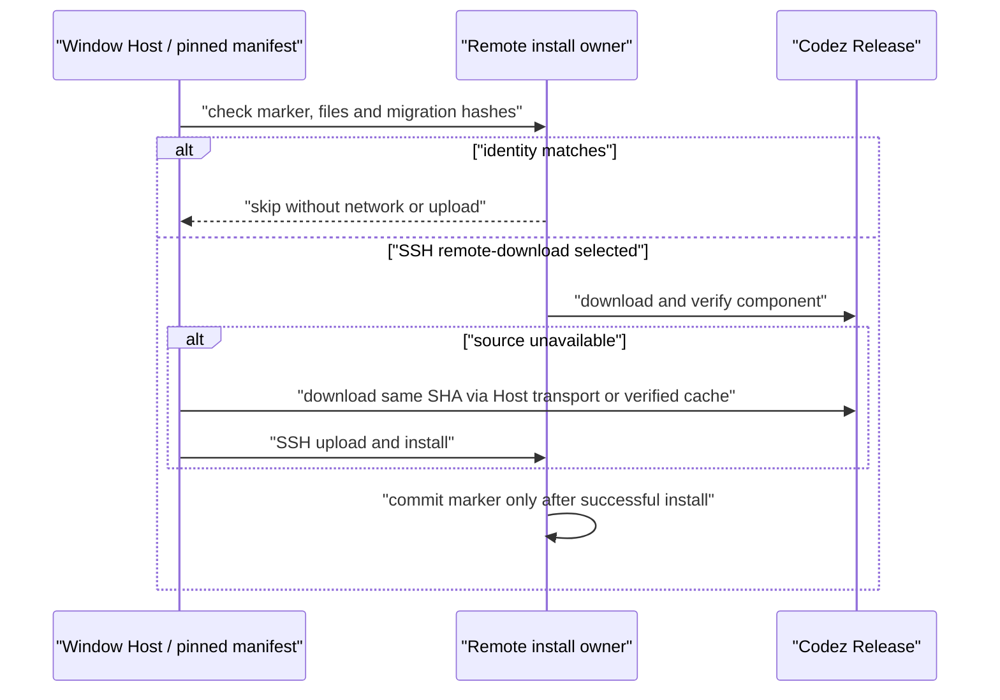

# Codex desktop distribution

Status: unsigned six-target distribution accepted on 2026-09-22. GitHub Actions
run `35713167778` passed on source `a1dcf9d`; see
`docs/codex-desktop-validation.md` for evidence and the remaining signing,
automatic-update and external remote-validation boundaries.

The fork publishes Codez desktop builds from KingingWang/Codez. Preserve
upstream history and license notices. Use an independent application identity,
desktop data directory and update feed; do not update a fork install to upstream.

Each workflow run first checks the latest published stable KingingWang/codex
release. When that release is missing a required native target (for example,
Windows assets uploaded after macOS/Linux), the resolver inspects at most ten
releases in GitHub's newest-first list and selects the first earlier published
stable release whose six target assets each have a valid GitHub digest and
positive size. All six
assets must come from that **one release**; it never combines a new partial
release with older binaries. A newly completed latest release wins even if its
assets arrive between the two reads. An unexpected tag, malformed asset
digest/size, failed GitHub read, or absence of a complete release within the
bounded list still fails closed (bounded retries may repeat the read).
Drafts and prereleases never enter the stable desktop distribution. The chosen
run-scoped manifest and tag are shared by every job; the checked-in manifest
remains the local-development fallback, never the CI fallback. Download only
the selected target's complete `codex-package-<target>.tar.gz` asset, validate
its GitHub SHA256/size before extraction and atomic staging, and package it
outside ASAR. No adjacent checkout dependency.

## Complete native Codex package (tool-host repair)

The standalone `codex-macos-aarch64` executable is not a complete tool runtime.
The fork's matching package archive contains `bin/codex`,
`bin/codex-code-mode-host`, `codex-package.json`, `codex-path/rg`, and
platform-specific `codex-resources/` executables. Codez 3.15.1 copied only the
standalone executable and bridge, so a fresh install could initialize app-server
yet fail Bash and browser tool calls with `codex-code-mode-host: No such file or
directory`. Reinstalling the same installer cannot supply the missing file.

The release resolver accepts a stable release only when **all six** package
archives carry positive sizes and valid SHA256 digests. Manifest schema v2
selects package archives rather than standalone binary assets; the local
fallback is also a complete package release. Keep upstream's package-relative
layout under `resources/codex/` (and the remote `codex/` mount), alongside
Codez's `bridge.cjs` and `distribution.json`:

```text
codex/
  bin/codex[.exe]
  bin/codex-code-mode-host[.exe]
  codex-package.json
  codex-path/rg[.exe]
  codex-resources/[...]
  bridge.cjs
  distribution.json
```

When a target package archive has an empty `codex-resources/` directory (for
example macOS packages that no longer bundle a private `zsh` helper), Electron
Builder's file-level `extraResources` copy omits the empty directory. `afterPack`
recreates `codex/codex-resources` before `verifyCodexResources` runs so packaged
resources keep the canonical four-root layout required by `inspectCodexPackage`
and Codex daemon seeding, and `mac.binaries` only includes optional helper
executables under `codex-resources/` when they are actually present in the staged
package.

Build scripts own verified archive download, safe relative-path extraction,
target/layout validation, executable-mode and per-file integrity checks, and
immutable staging. Electron Builder and remote producers consume that one
staged package; the Host bridge resolver invokes `codex/bin/codex[.exe]`.
Remote descriptors and bundled-asset verification must agree on the package
digest and executable path. No UI, session, queue, relay, or workspace owner
changes; desktop continuous and mobile replayable remain separate consumers
of the same running Host.

```mermaid
sequenceDiagram
    participant CI as "CI / local staging"
    participant U as "Verified Codex release"
    participant P as "Desktop / remote package"
    participant H as "Host"
    CI->>U: "resolve one stable tag and six package digests"
    U-->>CI: "target tar.gz"
    CI->>CI: "verify SHA256, layout, target and tool host; atomic stage"
    CI->>P: "copy complete package plus bridge"
    P->>P: "afterPack validates required files and hashes"
    H->>P: "start bin/codex; native tool host stays adjacent"
```

| Case        | Setup → action                                                     | Acceptance evidence                                                                                                                                     |
| ----------- | ------------------------------------------------------------------ | ------------------------------------------------------------------------------------------------------------------------------------------------------- |
| PKG-TOOL-01 | Incomplete latest release → resolve                                | Use one prior stable tag containing all six verified package assets; never mix versions or accept standalone-only releases.                             |
| PKG-TOOL-02 | Corrupted, truncated or unsafe package → stage                     | Reject before publishing; a missing or tampered tool host, package manifest, path helper or bridge fails verification.                                  |
| PKG-TOOL-03 | Six native targets → package                                       | Each installer preserves package layout and executable permissions/signing; `afterPack` rejects a missing tool host, not just a missing `codex` binary. |
| PKG-TOOL-04 | Four remote targets → materialize/install                          | The same package and `bin/codex` path survive component hashing, cache repair and Host startup without a legacy runtime fallback.                       |
| PKG-TOOL-05 | Real native binary + isolated loopback model → request a Bash tool | The tool executes and returns a result under a temporary home/workspace; an initialize-only handshake is insufficient release evidence.                 |

Cross-target distribution regressions may run on a host with a different filesystem
mode model (for example, staging a POSIX target fixture on Windows). In that case,
content, layout and checksums are still enforced, but the POSIX executable bit is
not inferred from the host filesystem; the six-target native matrix performs the
executable-mode check on matching Linux/macOS hosts. PKG-TOOL-05 keeps its
temporary home/workspace and loopback-model isolation, but uses full-access native
permissions where hosted Linux runners cannot configure the bubblewrap namespace.

Acceptance: given incomplete latest + a complete prior stable release, resolve
the prior release with its own six verified digests; if the latest finishes before
the list read, use latest instead. Ignore draft/prerelease candidates. Reject
malformed tags/digests/sizes, missing latest in the bounded list, all-incomplete
lists and API failures without publishing a manifest. The six-target CI smoke
and installer checks still validate the actual chosen native version before any
release is published.

CI uses Node 24.14.0 and pnpm 10.33.2, frozen dependency installation, typecheck,
lint, architecture and adapter tests. Build six native targets with fail-fast
disabled to collect independent results, but never mask an individual failure.
Smoke-test Codex handshake and package resources. Upload installers and SHA256
manifests. Every branch and tag push builds and runs the full gate, but only a
main-branch push automatically publishes a public release after all six targets
pass; side-branch and tag pushes stop at verified build artifacts, and pull
requests never publish. Build jobs need read-only repository permissions.

Installer artifact transport allows at most two complete upload-action attempts
per native target, in addition to the action's own request retries. A failed
first attempt admits exactly one retry using the same platform artifact name,
file selection and retention. Only that retry may replace a partial artifact
owned by this run/target; it cannot replace another target or another run.
First-attempt success skips retry, and final upload failure still fails the
native job and blocks release. Cancellation does not admit retry. This recovers
transient GitHub `CreateArtifact` timeouts without rebuilding successful installers
or treating unavailable artifacts as a successful publication.

```text
native installer/checksum owner → upload → success → build accepted
                                   └ failure → one same-target replacement upload
                                                  ├ success → build accepted
                                                  └ failure → job fails → release blocked
```

### Native Computer Use build inputs

The native matrix owns preparation of the explicit Computer Use Helper inputs
before Electron Builder runs. The macOS jobs use the real, regular executable
installed by `actions/setup-node`, its exact Node version and SHA256 as
`CODEZ_CUA_MAC_NODE_EXECUTABLE`, `CODEZ_CUA_MAC_NODE_VERSION` and
`CODEZ_CUA_MAC_NODE_SHA256`. The existing Helper stager still verifies the hash,
version and target Mach-O architecture before injecting the SEA payload.

Each Linux architecture builds xa11y 0.15.0 from its pinned upstream source
revision `a3badccf5761615ea3412ee55c19ac3764e27913` (the npm release's
`gitHead`) inside the matching native `manylinux_2_28` container, using
Rust 1.95.0 and the upstream Cargo lockfile. That revision's JS lockfile still
records the six path crates as 0.14.0 and misses two existing dependency edges;
apply the repository's bounded lock correction to a disposable source copy,
then build with `--locked`. Do not upgrade registry dependencies or modify the
checked-out source. The build
exports the resulting native package's absolute root as
`CODEZ_CUA_LINUX_XA11Y_NATIVE_ROOT`; the existing stager remains the owner of
package identity/version, ELF architecture and maximum GLIBC_2.28 validation.
Do not substitute the npm prebuilt addon, remove the required-input gates or
make Computer Use optional to turn a broken packaging run green. Windows
continues to consume its existing native package without either override.

```text
native matrix
  ├─ macOS setup-node executable → version + SHA256
  ├─ Linux pinned xa11y source → native manylinux_2_28 build → package root
  └─ Windows existing native package
       → afterPack validates and stages Helper → installers → six-target release gate
```

Acceptance: workflow regressions require the platform-specific preparation to
precede installer packaging and retain all six native targets and existing
failure gates. The macOS preparation is executed with a temporary environment
file and checked against the actual Node bytes. Linux native builds must pass
the existing runtime-staging identity, ELF and glibc checks; real macOS/Linux
installer jobs must pass before publication. The Linux regression job also
runs the Computer Use Helper tests and platform stager tests once. Fixtures
with a virtual Helper PID must inject the exit-confirmation seam; they must
never depend on whether the CI host happens to have a live process with that PID.
The bounded xa11y lock-correction regression must accept both LF and CRLF
checkouts while enforcing the same exact six path-version changes and two
existing dependency additions; line-ending conversion must not weaken or fail
the content checks on Windows.

Packaging keeps the native target identity explicit across platforms: Electron
Builder's numeric architecture values are normalized to the configured x64 or
arm64 target before `beforePack` validates the staged Codex resources. Gen UI
vendor files are byte-stable across Windows and POSIX checkouts, and their
manifest SHA256 values are verified before copying them into the desktop
runtime; line-ending conversion must never alter a vendored asset.

Codex packages do not carry the legacy `resources/glm` agent plugins. Their
`afterPack` checks therefore skip the legacy CUA Sharp and koffi asset assertions,
while retaining Codex runtime, remote assets, PTY and native-resource checks.
Explicit legacy builds still require the target-specific CUA native assets;
Sharp keeps its existing real-producer gate. Regression tests execute both
assertions for all six targets and verify that missing legacy assets still fail
legacy packaging.

The Linux regression gate also explicitly runs the UI tests for workspace-scoped automation model reads, valid default-model submission, and clean-repository Git tools. These tests live outside `settings/codex/` and must not be lost by relying on that directory glob alone. Test-path coverage is asserted by the workflow regression test; native six-target build, smoke and release gates stay unchanged.

Each native build calls the root `pnpm typecheck` once; that script already includes the Codex bridge typecheck. Do not repeat the bridge typecheck as a separate workflow command. A regression asserts both the root-script coverage and the absence of the redundant command, without dropping any per-platform check.

The workflow owns the validation step's Node heap budget: set
`NODE_OPTIONS=--max-old-space-size=4096` on that step for all six native targets.
The full TypeScript project-reference check exceeds the approximately 2 GiB
default heap observed on both macOS runners. Keep the override step-scoped:
local scripts, runtime smoke tests and packaged applications retain their own
defaults. Heap exhaustion or a failed check still fails the job; no check is
skipped or retried to hide an error. Acceptance asserts the effective override
for every matrix target and requires both macOS architectures to pass the real
workflow before publication.

## Per-push release publication

Automatic publication is main-only. A side-branch or tag push used to publish a
prerelease as well: it never took the Latest slot, but it did take the newest row
of the release list, and manually downloading that row silently installed a build
without main's fixes. Because every build reports the same `package.json`
version, the desktop auto-updater can never hand over a newer build either, so
the release list is the only real install path and its top row must always be a
main build.

Two layers enforce that and both are regression-tested. The workflow's
`release.if` admits a `push` only for `refs/heads/main`, and `releaseIdentity`
throws for any non-main `push`, so a later workflow edit cannot quietly reopen
the path. Non-main installers stay available through an explicit
`workflow_dispatch` with `publish=true`; those keep their prerelease marking and
never become Latest.

## Product identity

Codez is the fork's public product name. Repository, package, command,
environment-variable, desktop registration, deep-link, data-root, artifact, and
release names use the `Codez` / `codez` / `CODEZ` spelling. The legacy Codez
service host and service path remain unchanged when they identify an external
API contract rather than this product.

The release job is the only publication owner and the only job with contents-write
permission. It accepts artifacts from its own successful workflow run, verifies
all six installer/checksum sets and four target remote component sets, uploads
them to a draft, verifies the uploaded names, sizes and SHA256 digests, then
publishes that draft. A failed build or upload must not expose a partial public
release. The upload set covers each target's installers and updater metadata
(channel `<arch>-latest*.yml` and differential `*.blockmap` files), plus the
build-pinned remote component assets, so published releases feed both the Codex
automatic updater and remote deployment directly.

```text
push → remote assets → six native builds → verify checksums → draft upload
                                                         → verify assets → public release
```

Each run uses `codez-build-<run-id>-<short-sha>` targeting the exact built
commit. Reruns reuse that identity: incomplete drafts may resume; a complete public
release is verified without overwriting its assets. Unexpected ownership, commit,
assets or digests fail closed. Spaces in public asset names are normalized to dots
with corresponding regenerated checksum manifests, avoiding GitHub name rewriting.

Push runs do not share a branch concurrency group: a later push must not replace
an earlier pending build. Only superseded PR checks may be cancelled. Main pushes
publish stable releases; every other ref publishes only through manual dispatch
and stays a prerelease. Only a build that still matches the current main head is
eligible to become Latest, preventing an older slow build from deliberately
replacing a newer main result. Manual dispatch keeps an explicit publish switch,
enabled by default. The workflow token creates release tags without a separate
user-token push loop. GitHub's explicit workflow-skip commit markers and
platform/account execution limits remain external trigger constraints.

Acceptance includes trigger/concurrency/permission tests, the main-only automatic
publication guard asserted at both the workflow condition and `releaseIdentity`
layers, and a dispatched non-main run still publishing as a non-Latest
prerelease; six-target completeness, checksum corruption and duplicate/path
rejection; draft upload failure; same-run rerun; published-release immutability;
and one actual main-push release with all six targets and public download assets.
Existing validated source/installer records remain historical evidence, not proof
of this new publishing path.

macOS: DMG; Windows: NSIS; Linux: AppImage/DEB initially. A platform is accepted
only after its actual job succeeds. Unsigned artifacts are labelled as such;
signature/notarization and automatic-update trust need configured credentials.
Do not silently substitute legacy remote support to make a package build succeed.
Local desktop builds must succeed independently of remote deployment readiness.
Remote consumers use bundled native archives; missing or invalid assets fail
explicitly rather than preparing or deploying the old GLM CLI.

Public desktop dev/build/bundle commands and standalone builder configuration default
to `CODEZ_DESKTOP_RUNTIME=codex`, including the isolated Codex product flavor.
Only explicit `CODEZ_DESKTOP_RUNTIME=legacy` retains upstream identity/runtime behavior.
The dev entry prepares the verified native binary and builds the bridge before starting
Electron, then passes the selected native path to Host. No manual build prerequisite.

隔离桌面 GUI 验证在 Linux root 容器运行时，QA 启动器可仅向其临时 Electron
子进程设置 `ELECTRON_DISABLE_SANDBOX=1`，因为 Chromium 禁止 root 在默认沙箱
下启动。非 root、本地正式开发入口与发行包不得继承这个 QA 例外；探针仍使用
临时 HOME/CODEX_HOME 和回环假模型服务，不读取开发者账号。验收分别检查 root
容器能够启动并暴露 QA CDP，以及普通进程不改变 Electron 沙箱设置。

## Runtime isolation and remote boundary

`codex` is an explicit product flavor, independent of test/production backend.
Main owns the desktop identity: Codez (Codez Dev when unpackaged),
the `codez-codex` protocol and OS registration names. It must not consume
`codez:` links or overwrite upstream desktop/Finder/Explorer registrations.
Electron userData/sessionData use that identity. Business storage keeps the
existing services path contract under an isolated base: by default
`~/.codez-codex/.codez/v2`; an explicit custom base is namespaced with
`.codez-codex` too. Bootstrap settings stay anchored in the fork's home root,
and Main forwards the resolved base to Host before services are created.
No upstream settings/credentials/cache are migrated or reused implicitly.

Remote auxiliaries follow the same flavor layout. Agent launcher wrappers are
generated from the current layout root: `runtime_root` defaults to
`$HOME/.codez-codex/server` (codex) or `$HOME/.codez/server` (legacy), resolving
both the node binary and the agent bundle from it, and deployments rewrite the
wrapper on content mismatch on every backend (SSH/Docker/WSL), not only WSL.
Prompt attachments stage under `<data-base>/tmp/prompt-attachments` where the
data base is `~/.codez-codex` for codex and `~/.codez` for legacy. References
under the pre-isolation `~/.codez` root stay recognized and cleanable; orphaned
pre-switch tmp files are left in place without migration.

```
compiled codex flavor → Main identity/bootstrap owner → isolated settings/base
                                                  └→ Host env → services paths
verified release asset → immutable staging → resource checks → packaged Codex
```

Runtime update checks for Codex resolve only to KingingWang/Codez releases.
The private Desktop workspace package carries a valid development SemVer (`0.0.0`)
because standard `dev.mjs` launches Electron against that package and updater
construction reads its version before update-disable policy runs. No QA-only
updater replacement is permitted; release builder metadata overrides this with
the root release version.

## Automatic updates (Codex flavor)

Codex installs auto-update from KingingWang/Codez GitHub releases through
electron-updater's GitHub provider. The upstream server manifest provider and
its stable/preview channel switching never apply to this flavor, and
`autoUpdater.allowPrerelease` stays `false`. Builds use a per-architecture
channel (`x64-latest` / `arm64-latest`): the publish config channels the
per-target updater metadata into distinct file names, so the six targets of one
release publish side by side without overwriting each other. At runtime the
main process passes that channel explicitly in `setFeedURL` — electron-updater's
GitHub provider resolves the channel only from the feed options (or
`autoUpdater.channel`) and never re-reads the baked `app-update.yml` once a feed
is installed, so an omitted channel silently falls back to `latest` and 404s on
`latest-mac.yml`. electron-updater appends its platform suffix to that channel
and fetches exactly one metadata file from the release marked Latest, then
verifies the SHA512 checksums recorded there before installing:

| platform | updater asset set per target                                                                                                              |
| -------- | ----------------------------------------------------------------------------------------------------------------------------------------- |
| macOS    | `Codez-<version>-mac-<arch>[-unsigned].dmg`, `.dmg.blockmap`, `.zip`, `.zip.blockmap`, `<arch>-latest-mac.yml`                            |
| Windows  | `Codez-<version>-win-<arch>[-unsigned].exe`, `.exe.blockmap`, `<arch>-latest.yml`                                                         |
| Linux    | `Codez-<version>-linux-<arch>[-unsigned].AppImage`, `.AppImage.blockmap`, `.deb`, `x64-latest-linux.yml` / `arm64-latest-linux-arm64.yml` |

macOS updates require the zip artifact (dmg cannot drive Squirrel.Mac); the dmg
stays the manual-install option. The deb is installer-only and never
participates in updates. Checksum manifests and release upload validation cover
the exact asset sets above; anything else fails closed.

The release job still creates a draft, uploads and verifies the full set, then
publishes: current-main stable builds become Latest, and the only other refs that
ever reach publication are manually dispatched ones, which stay non-Latest
prereleases that `allowPrerelease=false` never offers. Runtime
behavior keeps the shared desktop policy: `autoDownload` remains `false`, the
user's auto-download preference drives any background download, and no
unconditional background install happens. Preview/production flavors retain
their existing manifest-provider behavior.

### Fork Source Server releases

Codex-fork CI builds Source Server artifacts with the canonical
`prepare:remote-assets` producer and publishes the exact five-file set to the same
GitHub Release as the installers: `source-server-release.json` plus one
`codez-server-<linux|darwin>-<x64|arm64>.tar.gz` per target. The release job
re-reads the descriptor, verifies every referenced archive's size and SHA-256,
and rejects an incomplete, duplicate, or unexpected asset set before publication.

The Desktop build injects the current GitHub run's immutable
`releases/download/<codez-build-…>` URL as its Source Server release root. GitHub
release roots are already exact release roots, so runtime URL construction must
not append the app version a second time. Descriptor-relative archive URLs and
the existing Host network policy remain unchanged.

The desktop workspace Help menu exposes the existing manual update command for
both production and Codex product identities. Preview keeps that entry hidden,
and Web never renders it. The Help menu subscribes to Main's update state;
its click passes through `CheckForUpdates` to the sole Main updater owner.
When an update is already downloaded, Main's existing command installs it on
restart; the renderer must not create its own update state or download path.
An unpackaged development build may report the existing `dev-skipped` outcome.
Acceptance: open Help in each product flavor, confirm the visibility matrix;
on Codex desktop select the entry and confirm the platform command is sent.
Testing a real installation requires an isolated packaged build and a known
test release, not a developer's installed app or a published release mutation.

Unsigned builds are not signature-gated: Windows NSIS skips signature
verification when no publisher name is baked, and Linux has no signature gate.
macOS compares an update against the running app's code-signature identity, so
unsigned builds carry no certificate identity to pin either. Update integrity
therefore rests on the metadata SHA512 checksums fetched over HTTPS from
GitHub; introducing signing later must keep one stable Developer ID identity.

Installs older than the first updater-enabled release can never discover it
because their updater was disabled; they must install that one version manually
from the release page. Afterwards updates are automatic.

Remote Codex requires the complete native Codex package plus bridge, Node compatible with
the bridge, server bundle, PTY and search components. A Codex component is not
a GLM component and must not be renamed to satisfy the old deployer. Producer
manifests and hashes are distinct; deployment must also adopt a fork-specific
remote root, component mount rules, startup env and bridge path resolution.
Consumers implement this contract through the existing deployment owner. Actual
external SSH/WSL transport remains separate from local artifact/install validation.

`scripts/codex-runtime-remote-assets.mjs` prepares all four darwin/linux x64/arm64
remote targets. These differ from the six native desktop installer targets:
Windows Desktop connects to Linux WSL, not a Windows remote runtime. Each
installer carries only its own complete native Codex package plus a small,
verified remote manifest/index; it does not carry the remote component archives.
Development staging uses `packages/desktop/bundled-resources/codex-remote/`.
No target is compiled locally.

The remote-assets job builds the existing standalone server once per target and
assembles Node 24.14.0 (official SHASUMS pins), Codex/bridge, target PTY prebuilds,
repository search tools, notices and per-file hashes. It never builds the legacy
agent. The six native desktop jobs download the same complete remote assets artifact.
Build and packaging verify every selected archive, but package only the four
current manifests and build-scoped index. The index pins the exact Codez release
tag, app version, target manifests and their SHA256 values; app version or Latest
alone cannot identify a build. CI tags include the workflow run and commit;
unpublished local tags include a digest of all four manifests so rebuilding the
same app version with changed bytes cannot reuse an earlier sidecar. The release
job uploads flat-named component assets with all six installers to one draft,
checks the exact asset set and digests, and publishes only after everything is
complete. PR/unpublished builds
retain the four-target CI sidecar artifact. A packaged unpublished build can
use a selected-target sidecar copied to `<remoteCacheDir>/imports/<build-tag>/`;
a development checkout with `packagedRemoteAssetsDir/components/**` may also
consume its verified local archives directly. In both cases the index and archive
hashes must match before use. No new importer UI or legacy
Codez CDN fallback is introduced.

The consumer contract is the existing `RemoteAssetManifest` schema:

```
codex-remote/
  releases/<appVersion>/manifest-<platformArch>.json
  releases/<appVersion>/runtime-<platformArch>.json
  components/<platformArch>/<id>/<archiveSHA256>.tar.gz
```

Manifest fields: `schemaVersion: 1`, `appVersion`, `platformArch`, `components`.
Each component has `id`, `version`, `sha256`, `artifactPath`, `mount`; artifact paths
are relative to the sidecar root. Release asset names are a flat deterministic
mapping from these paths, not a CDN-style nested URL. Mounts are `server`,
`node/<platformArch>`, `node-pty/<platformArch>`, `codex`, `codex-bridge`, and
`tools/<platformArch>/{bfs,ripgrep,ugrep}`
on Linux. macOS preserves the existing remote tool contract (ripgrep 13 only),
not the different desktop-local search plan. Tool versions retain archive revisions.
The native component is `codex-native`, using the verified fork release package
without Codez bridge bytes. The `codex-bridge` component carries only
`bridge.cjs` and `distribution.json` and installs into the same final `codex`
directory without replacing an unchanged native component. Other component ids
are unchanged. Producers must make unchanged component archives reproducible
(stable order, timestamps, ownership and modes); test identical inputs twice.
Materialization uses target- and SHA-scoped caches, since `codex` is a fixed mount.
Runtime descriptors record the integrated component mounting, fork-root, startup-env
and deployed bridge resolver contracts rather than a stale `deploymentReady` flag.
SSH/WSL transport validation remains explicitly `not-run` until exercised against
real targets; that validation record is informational, not a feature-disable switch.
Main passes the packaged index/manifests and a Codex-only cache through Host to
the server's existing deployment owner. The server selects the detected target,
pins its manifest and compares the remote marker and required files before any
network request. Matching components need no download or upload. At an app
version boundary, verify actual remote native/bridge file hashes before trusting
old markers; if verification is unavailable, repair conservatively. A legacy
monolithic `codex-runtime` may be adopted into the new identities only after
actual file verification. Main does not extract or select targets. Home/root
placeholders require explicit remote-home resolution, never unquoted shell
interpolation.

SSH retains its two persisted choices. `local-download-upload` remains the
default and uses the Desktop cache then SFTP (or the SSH backend's existing
exec-pipe fallback). `remote-download` first attempts the pinned Codez Release
on the remote. Missing curl/wget or checksum tools, or an unavailable source, falls
back once per connection to the Desktop-owned network transport and the same
pinned component, then uploads. Integrity, extraction, permissions, filesystem
and cancellation failures never silently fall back. Both transports require
remote `tar`; a missing tar is a deployment error. A verified local sidecar
or cache may be used without GitHub access on either machine. When neither
machine can fetch and the cache is empty, fail visibly. WSL/Docker retain the
local-upload path; mobile attachments reuse the existing Host, not a new deployer.
If every release URL fails, only transport failures qualify as unavailable;
any downloaded-but-mismatched SHA must remain an integrity error, even when
a later mirror is unreachable. A valid later mirror may still succeed.
Concurrent Desktop downloads and materializations deduplicate in-flight archive
fetches and publish verified archives atomically; one canceled caller must not
abort a shared download while another caller is still waiting, and a canceled
or partial copy cannot appear as a completed cache entry.
A caller that arrives after every waiter of a shared download has canceled must
start a fresh download instead of joining the aborted in-flight task.



The package helper can also produce a flat standalone server archive for isolated
smoke; it is not a second deployment protocol. `scripts/codex-runtime-remote-smoke.mjs`
extracts verified native components and checks Node/server execution offline.

### One remote asset producer per workflow run

The `remote-assets` job is the only CI owner of remote component archives,
manifests and `index.json`. All six desktop build jobs consume that exact
artifact with `CODEZ_CODEX_REMOTE_ASSETS_READONLY=1`. They verify the native
package pin, Bridge, manifest and archive hashes, but must not rebuild the
remote server, repack components or rewrite the index. A local Windows/macOS
server bundle or filesystem mode can differ from the Linux producer; that is
not permission to replace the pinned remote assets. Missing, stale or damaged
producer assets fail the consumer build. Local development without the flag
retains verified preparation and refresh.

After validating the actual packaged `resources/codex-remote` files,
`afterPack` copies their index into
`codex-remote-index-<desktop-os>-<desktop-arch>.json`. Each desktop artifact
includes this internal receipt. Before creating or uploading a release, the
release owner requires all six receipt hashes to match the producer's index.
Receipts are CI evidence, not public release assets. A same-tag, same-version
index with different component hashes is still rejected.

```mermaid
sequenceDiagram
    participant P as "remote-assets (sole producer)"
    participant B as "Six native desktop builds"
    participant I as "Packaged resources"
    participant R as "Release owner"
    P->>B: "one verified component set and index"
    B->>B: "read-only validation; no remote rebuild"
    B->>I: "copy pinned index and manifests"
    I-->>R: "six afterPack index receipts"
    P-->>R: "original index and release archives"
    R->>R: "require identical index hashes before publication"
```

Acceptance covers a consumer on a different OS preserving every producer byte
without invoking remote preparation, missing/corrupt inputs failing without
refresh, all six receipt hashes matching, and an otherwise valid regenerated
Windows index blocking publication before any GitHub write. The native matrix
and a real Windows installer audit confirm that every requested remote asset
name exists in the published release.

Integrated consumer boundaries:

- `packages/server/src/remote/remoteAssetCache.ts`: recognize `codex-native`
  and `codex-bridge` and their distinct mounts; retain archive/hash validation.
- `deployShared.ts`, `deploy.ts`, `codezAgentDeploy.ts`, `connect.ts`: isolate
  `~/.codez-codex/server`, deploy Codex instead of GLM/plugin packages, retain
  identity/lease/refresh guards, and pass explicit resolved remote paths.
  A server app-version refresh alone must not force-upload unchanged native
  Codex; preserve retry protection for partial two-component deployment.
- `packages/services/src/codez-agent/codexBridgeCommand.ts`: resolve the
  deployed bridge via `CODEZ_CODEX_BRIDGE_PATH`; invoke the remote Node with
  the bridge and pass the pinned executable through `CODEZ_CODEX_COMMAND`.
- Remote Node uses 24.14.0 rather than the old producer's 22.16.0, with pinned
  checksums/notices. Codex app configuration stays owned by
  native Codex; desktop does not copy credentials to satisfy startup.

Acceptance: explicit flavor and fallback tests; disjoint bootstrap/data roots;
Codex-only deep-link parsing and OS registrations; manual updates cannot reach
the upstream provider; verified real bridge build; mocked remote component
integrity and explicit failure for unsupported deployment; root typecheck/lint
and desktop build with any cross-owner integration failures reported.

Remote distribution acceptance:

| Case         | Setup and action                                  | Required evidence                                                                                                                                                             |
| ------------ | ------------------------------------------------- | ----------------------------------------------------------------------------------------------------------------------------------------------------------------------------- |
| CD-REMOTE-01 | Package six native targets                        | Only local native Codex and four small pinned manifests/index enter each installer; audit real installer sizes against the 500 MiB target.                                    |
| CD-REMOTE-02 | Publish a build and install to a fresh SSH target | The pinned release contains the exact four target asset sets; remote-download verifies its target and starts Node, server, Bridge and native tools.                           |
| CD-REMOTE-03 | Remote GitHub blocked, Desktop reachable          | Explicit remote-download falls back to one Desktop download/cache and SSH upload; saved choice survives reconnect with no redundant transfer.                                 |
| CD-REMOTE-04 | Both sources unavailable                          | A valid sidecar/cache installs; without one, fail visibly. Corruption, cancel and permission failures never fall back or commit success markers.                              |
| CD-REMOTE-05 | Codez or Bridge changes, native package does not  | New server/Bridge deploy; native package transfer is zero, even across app-version changes and old-marker migration.                                                          |
| CD-REMOTE-06 | Native package changes or install is interrupted  | Only the selected remote architecture updates; retry completes both component identities before starting the runtime. WSL/Docker and mobile Host attachment remain unchanged. |
| CD-REMOTE-07 | Windows/macOS consumes Linux-produced CI assets   | No remote rebuild or index rewrite; all six packaged-index receipts match the producer before release. A regenerated same-tag index or missing receipt blocks publication.    |
