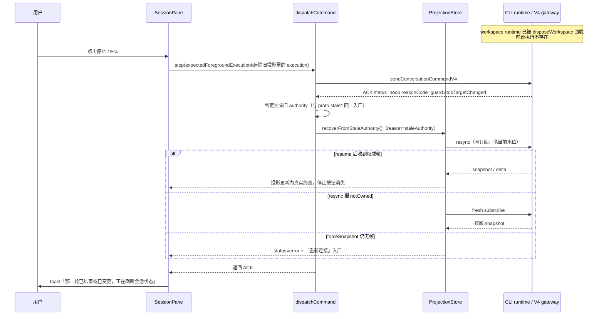

# 停止按钮命中陈旧投影时必须可见并自愈

Status: 2026-11-23 新增。

## 背景与根因

线上现场（Desktop 3.18.2 / commit `ff5c3ffa`，远程 workspace
`remote:server:f0667288…:/ice/yjy/workspace/20261116_ML/ML-FOSS-agent-system`，
会话 `01a20723-dcea-7483-8537-b4f13d005476`）出现「会话卡住半小时、按停止键没有任何反应」：

1. 15:39:32 在 Codex 供应商设置里写入模型目录，15:39:38 确认「重启 app-server」
   → `codezAgentService.disposeWorkspace` 回收该 workspace 的 agent runtime。
   这是 [供应商管理规格](codex-model-provider-management.md) 明确允许的行为
   （「中断该工作区在途任务，需用户确认」）。
2. 该会话当时有一轮在途（turn `01a20757-7434`）。runtime 被回收后不再产生终态帧，
   而 renderer 的 conversation store 仍持有 15:35:49 建立的订阅
   （`4452440b`，logEpoch `f28ca749`，seq 753，phase=running），
   此后 34 分钟没有收到任何一帧，也没有触发任何重连或 recovery。
3. 用户在 16:11:49–16:12:34 之间点了 23 次停止（9 次按钮 + 14 次 Esc）。
   `codez-agent.sendConversationCommandV4` 每次都 `OK`（9.5–17.9ms），
   但 runtime 侧 `stopActiveForegroundExecution` 返回 `idle`
   （前台执行不存在或已 abort），handler 抛 `guard.stopTargetChanged`，
   gateway 映射成 ACK `status="noop"`。
4. `SessionPane.handleStop` 只在 promise reject 时打 warn；noop 既不提示用户，
   也不触发任何投影刷新。生产构建下 renderer 日志不落盘，ACK 摘要只进有界调试缓冲。
   于是用户看到的就是「按了没反应」，面板永久停在幻影 running。

同一份日志里 stop 的正常工作路径是对照组：11:50:26、14:37:40、14:38:15、15:28:42
四次停止都在 85–180ms 内翻到 `completedInterrupted`。全天 68 个有快照的会话中，
只有这一个终态停在 `running`，且正是唯一在 dispose 时刻仍在跑的那个；
另两次 dispose（14:33:04、14:38:41）当时没有在途轮次，没有产生卡死。

结论：**这不是 runtime 侧 stop 守卫的缺陷**（精确目标守卫是有意的，避免误杀用户
没看到的新执行），**缺陷在 UI 侧把「目标已变更」这个权威事实静默吞掉了**。
[App 控制面设计](../docs/architecture/codez-app-control-design.md) §5.3 已经要求
「owner 因 `guard.stopTargetChanged` 返回 noop 时，工具必须报告 rejected，
不能把身份不匹配当成已停止」；会话面板的 stop 入口此前没有对称处理。

## 产品规则

- Stop 的结果必须可见：ACK 非 `accepted`/`duplicate` 时，用户要么看到状态变化，
  要么看到一条明确提示。禁止「命令发出去了但界面毫无反应」。
- `noop` + `guard.stopTargetChanged` 的语义是**本地投影陈旧**，不是「已经停了」。
  它与 `proto.staleLogEpoch` / `proto.staleRevision` / `proto.staleTarget` 同源：
  权威投影已换代，必须走同一套 same-sub recovery（`staleAuthority` 起因），
  由 store 决定 resume 还是 force snapshot，再决定 fail-closed。
- recovery 复用既有阶梯，不新增第二套重连路径：resume → 无帧超时升级
  forceSnapshot → 仍无帧则 `fault.subscription.recoveryFrameTimedOut` 落
  `status="error"`，露出「重新连接」。`fault.subscription.notOwned` 仍按既有
  规则 fresh subscribe 自愈。
- 提示只说明「那一轮已经结束或已变更，正在刷新会话状态」，不宣称已停止，
  也不把 noop 说成失败重试。
- 该规则同时覆盖桌面按钮与 Esc 两个入口（同一个 `handleStop`），
  以及本地与远程 workspace；不区分 `desktop-continuous` 与 `web-remote-replayable`。
- 不改动 CLI/runtime 的 stop 守卫语义、ACK 状态词表，也不放宽
  `expectedForegroundExecutionId` 的精确匹配。

## 所有者、接口与顺序

| 事实                     | 所有者                                      | 说明                                                        |
| ------------------------ | ------------------------------------------- | ----------------------------------------------------------- |
| 前台执行是否存在/是否匹配 | CLI runtime（`activeForegroundExecution`）   | 唯一权威；`idle`/`mismatch`/`stopped` 三态                   |
| stop 的 ACK 语义         | V4 gateway（`V4CommandNoopError` → `noop`）  | noop 不是失败，RPC 正常返回                                  |
| 会话投影与恢复阶梯       | `ConversationProjectionStore`               | 唯一 recovery 发起点；起因由调用点显式给出（`staleAuthority`） |
| 「陈旧 authority」判定    | `staleAuthorityRecovery.ts`                 | 纯函数；`proto.stale*` 与 stop 目标守卫共用同一入口           |
| 停止入口与用户可见反馈   | `SessionPane.handleStop` / `dispatchCommand` | 反馈走既有 toast；recovery 走既有 store 接口                  |
| workspace runtime 回收   | Host/runtime owner（`disposeWorkspace`）     | 既有行为，本规格不改变                                       |

- 桌面 continuous 与手机 replayable 共用同一个 store recovery 入口，
  不新增 stream/snapshot 链路，不改 owner/lease 或 workspace identity 边界。
- recovery 的起因必须是 `staleAuthority`，不从状态反推；
  [04-sync 规则 12](../docs/v4-refactor/04-sync-and-recovery.md) 要求每个入口可归因。

## 验收场景

1. 远程或本地 workspace 有一轮在途；通过 Codex 供应商设置确认「重启 app-server」
   回收该 workspace runtime；面板仍显示 running。点击停止：
   出现提示，且会话在既有 recovery 阶梯内离开幻影 running
   （拿到权威终态，或落 error 面板并露出「重新连接」）。
2. 同一状态下连续多次点击停止：每次都给出同一提示，不重复发起并发 recovery
   （store 的 recovery 单飞约束仍然生效），不产生新的订阅风暴。
3. 正常在途轮次点击停止：仍走 `stopped` 路径，
   在既有断言窗口内翻到 `completedInterrupted`，不出现新提示。
4. 停止时 runtime 已进入下一轮（verifier/continuation 交界，`mismatch`）：
   给出提示并刷新投影，用户能看到真正在跑的那一轮，绝不误杀它。
5. 只读分享、writer-conflict、selection-side chat：停止入口不可用，行为不变。

## 不在本次范围

- 「running 轮次长时间静默」的主动看门狗：目前唯一的自愈入口是 accepted input
  的 2 秒宽限期（`sendText`/`editUserQuery`）与用户显式操作。是否给 running
  投影加静默超时属于新的产品规则，需要先对齐，不在本次修复内。
- `disposeWorkspace` 与在途订阅之间的生命周期通知链路（renderer 是否应当收到
  runtime `unavailable`）。本次现场日志中该 store 没有收到任何生命周期事件，
  但远端 server/runtime 日志不在导出内，无法据此定位是通知缺失还是未被消费；
  留作独立调查。

## 回归证据

- E2E 候选（待人工审核与晋级）：
  `packages/desktop/test/e2e/conversation-session/execution/manual-review/pending/conversation-session-stop-stale-projection-recovery.test.ts`
- 覆盖矩阵登记见 `docs/testing/conversation-session-e2e-coverage-matrix.md`。
