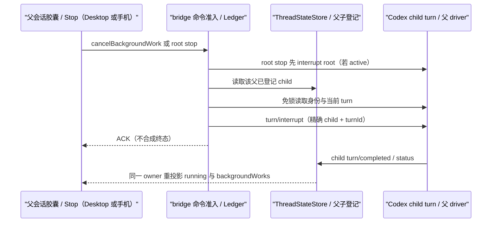

# Codex desktop subagent drill-down

## Outcome

Codex flavor 的子代理与原生 flavor 同形可下钻：父会话时间线里的 `spawn_agent`
卡片可点击，在右侧只读面板打开子代理自己的会话；状态面板显示运行中子代理并同样
可点；「已结束」目录通过 `session/subagents` 回看。子线程的事实源始终是 Codex
（独立 threadId + 独立 rollout），bridge 只翻译，不新建持久化、不复制历史。

原生参照：`packages/ui/src/v4/ConversationAgentToolCallRow.tsx`（卡片入口）、
`packages/ui/src/app-shell/SubagentSessionSidePane.tsx`（只读子会话）、
`packages/ui/src/v4/SubagentDrilldown.tsx`（行内迷你时间线，两种 flavor 均无挂载点，
本 spec 不接）。

## 事实源与标识

| 事实               | 来源                                                                                                                        | 用途                                                                                                                                                     |
| ------------------ | --------------------------------------------------------------------------------------------------------------------------- | -------------------------------------------------------------------------------------------------------------------------------------------------------- |
| `childSessionId`   | `subAgentActivity.agentThreadId`；无 activity 时取 `collabAgentToolCall(tool=spawnAgent).receiverThreadIds`（仅当长度为 1） | subagent 行、`snapshot.subagents`、side pane 订阅                                                                                                        |
| `parentToolCallId` | spawn 那个 collab item 的 `id`                                                                                              | UI 同 turn 配对                                                                                                                                          |
| 生命周期           | `subAgentActivity.kind` + 各 collab item 的 `agentsStates[childId].status`                                                  | 行/目录 status                                                                                                                                           |
| 名称与类型         | 父侧只有 `agentPath` 与 spawn `prompt`；真实 `agentNickname`/`agentRole` 只在子线程 `thread/read` 上有                      | `subagentType` 用 `subagent` fallback，标题优先 nickname                                                                                                 |
| 时间               | 行：只有 turn 级 `startedAt`/`completedAt`，item 无逐项时间戳。目录：`thread/list` 的 `createdAt`/`updatedAt`               | 行 `startedAt` = 锚定 turn 的 `startedAt`（同 turn 内的近似下界），行不设 `endedAt`；目录 `startedAt`/`endedAt` = 子线程 `createdAt`/`updatedAt`，不伪造 |

## 投影表

| 输出                                                                        | 规则                                                                                                                                                                                                                                                                                                                                                                                                                                                                                                                                                                                                                                                                                                                                             |
| --------------------------------------------------------------------------- | ------------------------------------------------------------------------------------------------------------------------------------------------------------------------------------------------------------------------------------------------------------------------------------------------------------------------------------------------------------------------------------------------------------------------------------------------------------------------------------------------------------------------------------------------------------------------------------------------------------------------------------------------------------------------------------------------------------------------------------------------ |
| `subagent` row                                                              | 每个 childThreadId 一行，锚定 spawn item 所在 turn 与位置；`entityId` = `codex:subagent:<childThreadId>`；`summaryText` = spawn prompt 首个非空行（≤200 字符）?? `agentPath` ?? `""`；不设 `backgrounded`/`workId`（Codex 无对应事实）                                                                                                                                                                                                                                                                                                                                                                                                                                                                                                           |
| 行 status 优先级                                                            | ① `subAgentActivity`：`completed`→success、`interrupted`→cancelled；② 否则 `agentsStates[childId].status`：`completed`→success、`errored`→failed、`interrupted`/`shutdown`→cancelled、`pendingInit`/`running`→running、`notFound`→无信息不覆盖；③ 都没有→running                                                                                                                                                                                                                                                                                                                                                                                                                                                                                 |
| 只有 activity 没有 spawn item 的历史                                        | 仍产出行，锚定首个 activity item，不带 `parentToolCallId`，走 UI 既有「同 turn 唯一剩余一对」legacy 配对                                                                                                                                                                                                                                                                                                                                                                                                                                                                                                                                                                                                                                         |
| `snapshot.subagents`                                                        | `childSessionIds` 去重；`running` 只含 status=running（收敛规则见下）；`endedTotal = max(0, childSessionIds.length - running.length)`；`revision`：空=0、非空≥1，仅在派生语义变化时 +1（renderer 用作 refresh key 与 child tab 同步 CAS）                                                                                                                                                                                                                                                                                                                                                                                                                                                                                                        |
| running 收敛（终态到达前不能把子代理从 running 拿掉，结束后也不能一直留着） | 父线程事实是主依据；但 v1 只在 `wait`/`send_input` 碰巧观测到终态时才写 `agentsStates`（实测多数 child 永远没有父侧终态），v2 只在 `Completed` 时写 `subAgentActivity`。因此 bridge 额外维护「子线程活性观测」：① 已加载子线程的原生 `status`；② 所有线程的 `turn/started`→active、`turn/completed`→非 active、`thread/status/changed` 按类型映射（子线程创建时原生会为已初始化连接自动挂 listener，事件无需打开子面板即可到达）；③ 一次性 `thread/list { parentThreadId, sourceKinds: subAgent* }` 种子：`active`→运行中，`idle` 且没有任何 turn →还在排队不判死，`idle` 且有 turn 且无 inProgress→已结束，`systemError`/`notLoaded`→已结束。命中「非 active」即不计入 running。子线程生命周期事件同时 touch 父会话触发重投影，不等下一次父事件 |
| `session/subagents`                                                         | `thread/list { parentThreadId, cwd, sourceKinds: subAgent*, modelProviders: [], archived: false }`；原生 status `active`→running，其余→ended；ended status 用父线程事实推导，不可判定用 `lost`；bridge 侧按 offset 分页并返回不透明 cursor，`ended.total` 为精确已结束数                                                                                                                                                                                                                                                                                                                                                                                                                                                                         |
| `session/subagents` 缓存与退避                                              | 父线程已加载的子代理事实与 `session/subagents` 分类结果按 `(parentSessionId, epoch, revision)` 及子线程活性版本做有界缓存（分页切片直接复用已排序列表）；`listChildThreads` 与种子调度对同一 `parentThreadId` 进行 in-flight 合并，并在原生 `thread/list` 失败时实施有界退避冷却，防止失败风暴                                                                                                                                                                                                                                                                                                                                                                                                                                                   |
| 分隔线 marker                                                               | `subAgentActivity` 的 `codexEvent` marker 保留不变（additive）                                                                                                                                                                                                                                                                                                                                                                                                                                                                                                                                                                                                                                                                                   |

## 只读边界

- 子线程判定：`thread/read` 返回的 `parentThreadId` 非空。bridge 内部标记
  `readOnly: "subagent-child"`。
- 加载顺序：`thread/read` → 按原生 `ThreadStatus` 分流 → `thread/turns/list` 免锁读历史。
  - `idle`/`active`/`systemError`（原生已把子线程加载进本进程）：走 `thread/resume`。
    此时 resume 的语义是「回放历史 + 原子订阅」（codex-rs
    `app-server/src/thread_state.rs`），不改写 rollout，用来拿子线程实时
    `item/started`/`item/completed`。
  - `notLoaded`：**跳过 resume**，只用 read envelope + `thread/turns/list` 做只读投影
    （`attached: false`）。原因见「已知边界与降级」的 rollout 改写条目。
  - resume 失败一律降级为 read envelope 只读，不要求 writer-conflict 错误签名。
  - 只读加载一律跳过 queue 读取。
- cwd：子线程放宽，物理路径不同也允许只读投影（child id 只来自父线程 item，不是用户
  输入）；可写线程仍按物理路径严格校验。
- 命令：child envelope 仍 deny-by-default；子代理用 `guard.subagentReadOnly`（与原生
  同 reasonCode），`forkAssistant` / `createSelectionSideSession` 逃生通道保留。
  availability 用同一 reasonCode 报禁用。停止从父 envelope 的既有命令进入，见下节。
- 不设置 `snapshot.writerConflict`：那条文案语义是「被别的窗口/进程占用」，与子代理
  只读不符。UI 只读由 side pane 的 `readOnly` prop + 命令层 deny 双层保证。
- 子线程不进任务列表：`store.list()` 现有 `sourceKinds: ["cli","vscode","exec",
"appServer"]` 已排除 `subAgent*`；`session/subagents` 是唯一按父查询子线程的入口。

## 已知边界与降级

- **resume 未加载线程会改写子线程 rollout**：实测（codex-cli 0.160.1，真实已结束父子线程）
  `thread/read` 与 `thread/turns/list` 不改盘；对 `notLoaded` 子线程首次 `thread/resume`
  会重写其 rollout 文件，并把 `thread.updatedAt` 顶到当前时间（同一进程内对已加载线程再次
  resume 不改盘）。`updatedAt` 正是 `session/subagents` 的 `endedAt` 来源，因此「打开子会话」
  会把已结束子代理的结束时间刷成打开时刻、并打乱按 `endedAt` 的倒序。规避方式就是上面的
  `notLoaded` 跳过 resume；`recencyAt` 不是结束时间（≈ 创建时间），不能替代。
- ephemeral 子线程无 rollout：`thread/read` 报 not materialized，卡片仍可点，
  side pane 走既有错误态，不造占位内容。
- 冷启（父线程未加载）：子线程通常是 `notLoaded` → 只读历史快照，不订阅；父线程后续
  activity 触发父快照重投影。父线程之后若再驱动该子线程，原生会把它加载进本进程，
  未 attach 的条目在 subscribe/resync 时被 `invalidate` 重载，那时状态已是 `idle`/`active`，
  再走 resume 订阅（自愈路径）。
- 名称与类型：父线程 collab item 经 API 投影后**不含** `receiverAgents`（rollout 里有，
  `thread/turns/list` 剥掉了），所以时间线行的 `subagentType` 只能是 `subagent` fallback、
  标题走 spawn prompt 首个非空行；真实 `agentNickname`/`agentRole` 只有 `thread/list` /
  `thread/read` 的子线程元数据上有，因此只在 `session/subagents` 目录与 side pane tab 出现。
- 子代理视图严格只读：不提供 child envelope 的发送/停止/重试/编辑；父会话胶囊
  和状态面板复用 `cancelBackgroundWork` 停止 child，不放开子会话写权限。
- 运行中判定：`snapshot.subagents.running` 以父线程事实为准，再按上表「running 收敛」的
  子线程活性观测把已结束的 child 从 running 里去掉（避免中断会话永久滞留「运行中」）。
  活性观测优先取已加载子线程的原生 `status`；未加载时取 bridge 记录的 turn/status 事件或
  一次性 `thread/list` 种子；都没有（无观测）时保持父侧事实不变。已加载缓存状态可能滞后于
  「父线程重新驱动该子代理」的时刻；未 attach 的只读条目在下一次 subscribe/resync 会被
  invalidate 并重判，因此滞后窗口只存在于子面板持续打开且未 resync 期间。子代理被
  `send_input`/`resume` 重新驱动时，子线程 `turn/started` 会把活性观测翻回 active，
  running 随之恢复——与原生「resume 即重新计时」同一语义。
- 分享投影：`subagent` 行按既有规则被公开载荷过滤；存在 running 子代理时按既有规则
  拒绝分享。

## UI 合同

- `SUBAGENT_TOOL_NAMES` 必须包含 codex 的 `spawn_agent`（`COLLAB_TOOL_NAMES.spawnAgent`），
  否则 `pairSubagentRows` 配不上对：卡片没有入口，且 subagent 行会作为独立行重复渲染。
- `send_input`/`resume_agent`/`wait_agent`/`close_agent` 等后续交互工具不进入该集合：
  同一 child 只允许一张可点卡片。

## 父会话停止子代理（issue #32）

根因已由源码确认：bridge 快照的 `backgroundWorks` 原本恒为空，胶囊及状态面板没有
可关联的 Stop；root `stop` 仅 interrupt root turn，child 可能继续运行。

- 每个 `snapshot.subagents.running` child 派生一条 `backgroundWorks`：
  `workId = childSessionId`、`kind = "subagent"`、`status = "running"`、
  `anchorRowId = null`，标题与开始时间沿用同一 running 投影（缺少时间用 thread 创建时间）。
  可写父会话为 `cancellable: true`；只读会话为 false，不暴露无法执行的控制。
  不声称原生 child 已 backgrounded，不给时间线 subagent 行添加 `workId`。
- 唯一父子登记仍由 `ThreadStateStore` 内的 `SubagentActivityTracker` 持有；
  快照完整历史的 child IDs 更新登记，不从窗口截断、标题、时间或用户输入推测关系。
- 父 envelope 的 `cancelBackgroundWork { workId }` 必须命中该父的已登记 child，否则
  fail closed 且不向目标发 RPC。登记命中后，用免锁 `thread/read` 验证返回 ID 与
  `parentThreadId`，并用 `thread/turns/list(itemsView = "notLoaded")` 查询当前 turn；
  不 resume child、不读取完整 items、不建立第二份执行状态。
  无 inProgress turn 时幂等 accepted；唯一 inProgress turn 时只向该 child/turn 发一次
  `turn/interrupt`。身份不匹配、多个 inProgress turn 或读取/interrupt 失败显式失败，
  不重试 outcome-unknown mutation。
- root `stop` 保留既有 `expectedForegroundExecutionId` stale guard，先 interrupt root；
  root interrupt 失败不级联。root 已 idle 也可停止已登记 child。随后逐个检查已登记
  child 的当前 turn，用同一 interrupt 实现尽力停止仍在运行的 child。
  单 child 失败只发闭合 `subagentStopFallback` stderr 诊断，不翻转 root Stop ACK，
  不泄露原生错误正文、凭据或路径；诊断回调失败也不影响 ACK。
- commandId 的幂等及 outcome-unknown 规则沿用 `CommandLedger`；child turnId 是
  精确执行目标。读取后 child 换 turn 时不改目标、不猜最新 turn、不自动重试。
  bridge 不合成 child 或父 Agent tool 的 interrupted 终态，不提前清空 running；
  Codex 父 driver 拥有工具结算，既有 child lifecycle 观测触发父快照收敛。
- UI 继续按唯一 `childSessionId` 精确关联 `controlWorkId`；缺失/重复身份不显示 Stop。
  不新增 child 侧 Stop、mailbox、发送入口或 live model/permission switch。
- Desktop continuous 与手机 replayable 均读取相同 owner 的快照/事件和发同一命令；
  本改动不改变 Host owner/lease、workspaceIdentity/remoteSessionId 路由或恢复链路。

## Acceptance

- #32 单测：running child 可取消投影；cancel 精确打断当前 child turn；结束后幂等；
  未登记/异父/错 ID/多个 running turn fail closed；重复 commandId 不重复 interrupt；
  child envelope deny 保留；root-first 级联、idle root、stale root、root 失败、
  单 child 失败及诊断失败不翻转 ACK；完成事件收敛 work 而非 ACK 合成终态。
- #32 原生集成：隔离 Codex HOME、合成慢流 provider，真实 pinned app-server + bridge
  验证 child interrupt 接受度、父 driver 结算，以及两种 delivery 的 work 收敛。
  UI 胶囊与 Stop 复用既有 V4 background E2E，不把 native Agent 路径当作 Codex 证据。
- bridge 单测：行投影（含并发两个 child 交错 activity 不串号）、只有 activity 的历史、
  `snapshot.subagents` 与 revision 语义、子线程只读加载三条路径（attach 成功 / resume
  被拒降级 / cwd 不同）、`notLoaded` 跳过 resume 与 `idle` 仍订阅、deny guard 的
  reasonCode、`session/subagents` 分页与分类、`session/list` 不含子线程。
- UI 单测：`spawn_agent` 行 + subagent 行恰好产出一个 `agentToolCall` 渲染项且 subagent
  行不重复渲染；有无 `childSessionId` 时 side pane 入口 testid 的出现与缺席。
- `pnpm typecheck`、`pnpm lint`、`pnpm architecture:check --changed` 全绿。

### #32 本次验证（2026-10-31）

- bridge 包：759 passed、4 个已有 opt-in native skip、0 failed；新增停止测试均执行。
- `node --test scripts/test-codex-subagent-stop.mjs`：真实 pinned Codex + bundled bridge
  验证父 cancel、两个 child 的 root 级联、原生 interrupted 结算和两种 delivery 收敛，1/1 PASS。
- 状态面板唯一 child 身份关联等 focused UI tests：28/28 PASS；根 typecheck、
  lint（117 条现有 warning、0 error）、changed 架构检查通过。
- 干净的隔离待提交快照执行 `pnpm verify:pre-push` 通过；affected 选择 0/2084 根 UT，
  未执行根 UT，bridge 的 Node 测试及原生集成由以上独立入口验证。
- 既有 `conversation-session-v4-background-work.test.ts` **未通过，不计入停止证据**：
  首次受继承的 `ELECTRON_RUN_AS_NODE=1` 影响无法启动；移除后，默认 Codex flavor 的
  legacy Provider 准备不匹配；显式 legacy 重跑仍在 `prepareV4ConversationE2E` /
  `selectRegistryProviderModelById` 等待选模 trigger 可点击时失败，未到达发送/Stop。
  最后一次 artifact：`packages/desktop/.e2e-artifacts/desktop-e2e-20261030162343068-p98109-12ad97bd4fd253c3/`。
  本修复不改 UI 或该准备器；此失败不代表 Codex 停止链路已被 GUI 验证。
