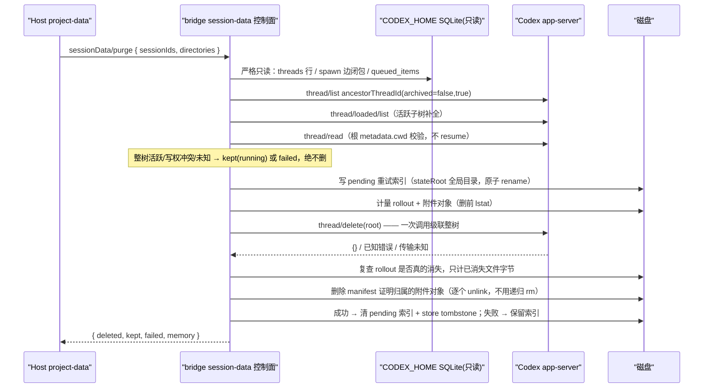

# Codex 后端的会话数据测量与彻底删除

状态：已实现（2026-11-02）。本 spec 只覆盖 Codex 原生桥接后端（`packages/codex-bridge`）对
`v4/storage/sessionData/measure` 与 `v4/storage/sessionData/purge` 的执行面；产品交互、Host 目录
扣除、任务索引行与检查点删除的规则不变，见
[2026-10-24-project-management.md](../docs/superpowers/specs/2026-10-24-project-management.md)
「彻底删除数据」与 legacy CLI 合同
[session-data/CONTRACT.md](../packages/shared/src/codez-protocol-v4/session-data/CONTRACT.md)。

## 问题

桌面默认后端是 Codex 原生桥接。bridge 的 `request()` 只登记了 conversation/attachment/command 等
方法，`v4/storage/sessionData/*` 落到 `unsupported(method)`（`packages/codex-bridge/src/json.ts:19`，
code `-32601`）。按 spec，Host 收到 method-not-found 就隐藏「同时删除 Codez 数据」选项，因此
Codex 后端下彻底删除**静默不存在**：原生 rollout、原生 state db 行、bridge 自有附件对象都不会被
清理，用户只能看到软删除。本次把它补齐，并且经用户批准直接调用原生 `thread/delete`。

## 载体边界（必须先读）

`v4SessionDataParams` 只有 `sessionIds` 与 `directories`，**不含 workspace**；Host 侧载体选择是
`measureSessionData → resolveGlobalSavedWorkflowCarrier()`（任一本机活跃 runtime，否则管理面进程）、
`purgeSessionData → getReadOnlyClient(cwd, "existing-only").catch(getPluginManagementClient)`
（`packages/services/src/codez-agent/codezAgentService.ts:5397-5415`）。因此接请求的 bridge 的
`store.cwd` 经常**不是**目标会话的 cwd（冷项目、已删目录、管理面合成 cwd）。

裁决：这是一条**已授权的本机全局 session-data 控制面**，不是工作区级会话面。

- 绝不按载体 `cwd` / `workspaceId` 过滤或拒绝 measure；也绝不用 `directories` 冒充会话 cwd。
- 每个会话先读原生 metadata（免锁 `thread/read`，不 resume），把**它自己的** `metadata.cwd` 作为
  删除原语的验证输入：必须是非空绝对路径，否则该会话按 `failed{code:"invalid-thread-metadata"}`
  保留，不删。
- 后代会话按 spawn 边归属，**不按 cwd**：子代理常跑在隔离 worktree 里，路径与根不同仍属同一棵树
  （与 `child-thread-list.ts:82-84` 的既有口径一致）。
- 远端仍然禁用：`purgeSessionData` 的 `project.data-local-only` 门禁与本机载体选择留在 services
  （root 所有），bridge 不新增第二条远端判定。
- 跨进程写权冲突保留：bridge 只读降级条目（`readOnly: "writer-conflict"`）与原生删除报错都不吞，
  按 `failed` 返回，Host 保留任务行供重试。

## 事实源（pinned ref `codex-20261020-001405`，只读核实）

| 事实                                                                                                                                                | 证据                                                                                                      |
| --------------------------------------------------------------------------------------------------------------------------------------------------- | --------------------------------------------------------------------------------------------------------- |
| `thread/delete` 自带整树级联：`state_db_spawn_subtree_thread_ids(root)` → 子先父后删除                                                              | `codex-rs/app-server/src/request_processors/thread_delete.rs:39-62`                                       |
| 子树 = `agent_graph_store.list_thread_spawn_descendants` ∪ 运行时活跃子树                                                                           | `codex-rs/core/src/thread_manager.rs:1056-1091`                                                           |
| 删除内容 = rollout 文件（含 `.jsonl.zst` 兄弟文件）+ 归档 rollout + thread name 索引条目 + state db 行 + agent message board                        | `codex-rs/thread-store/src/local/delete_thread.rs:203-311`、`codex-rs/core/src/thread_manager.rs:480-492` |
| state db 行含 logs / queue / versioned memory / goals / dynamic tools / spawn edges / read receipts / threads                                       | `codex-rs/state/src/runtime/threads.rs:1164-1214`                                                         |
| `thread_history` 只删 DB 行，不删文件                                                                                                               | `codex-rs/thread-store/src/local/thread_history.rs:244-284`                                               |
| fork 引用保护：被 fork 历史引用的线程整批拒绝，且检查先于任何清理与文件删除                                                                         | `delete_thread.rs:116-136`、`:154-201`                                                                    |
| 本 app-server 已加载的活跃线程会被关停再删：`prepare_thread_for_removal` 提交 Shutdown，超时也继续；不代表能强杀其他进程的线程                      | `thread_processor.rs:1069-1095`、`thread_delete.rs:43-45`                                                 |
| 跨进程写权保护：引用检查之后、文件清理之前取得整树 writer locks；foreign-owned descendant 会使整批删除拒绝                                          | `codex-rs/thread-store/src/local/delete_thread.rs` 的 `acquire_writer_locks` 及 foreign-owner 回归        |
| 未加载且解析不到 rollout 时以 `-32600 no rollout found for thread id X` 失败，且**在删任何行之前**返回                                              | `thread_delete.rs:88-125`、`thread-store/src/local/read_thread.rs:97-102`                                 |
| ephemeral 线程拒绝删除                                                                                                                              | `thread_delete.rs:80-87`                                                                                  |
| `thread/delete` 走 turn admission，drain 期返回 server-draining                                                                                     | `message_processor.rs:989-997`、`turn_admission.rs:48-63`                                                 |
| rollout 文件名语法 `rollout-<ts>-<threadId>[_<rolloutId>].jsonl[.zst]`，目录 `sessions/YYYY/MM/DD`、`archived_sessions/…`                           | `codex-rs/rollout/src/rollout_file_name.rs:39-74`、`codex-rs/rollout/src/list.rs:426`                     |
| `thread/list` 的 `ancestorThreadId` 返回任意深度后代（不含自身）；`sourceKinds` 省略或空数组会退回**只列交互来源**；`archived` 非 true 只返回未归档 | `app-server-protocol/src/protocol/v2/thread.rs:1424-1481`                                                 |
| 实验字段需 initialize 时 `capabilities.experimentalApi`，bridge 已开启                                                                              | `message_processor.rs:977-981`、`packages/codex-bridge/src/codex-process.ts:403-410`                      |
| state db / queue db 固定名 `state_5.sqlite`、`queue_1.sqlite`，默认 home = CODEX_HOME（可被 `sqlite_home`/env 覆盖）                                | `codex-rs/state/src/sqlite.rs:37-38`、`codex-rs/core/src/config/mod.rs:4232-4237`                         |
| 队列持久化在 `queued_items(thread_id,…)`                                                                                                            | `codex-rs/state/queue_migrations/0001_queued_items.sql`                                                   |
| 原生记忆是 DB 行（随线程删除），全局 `$CODEX_HOME/memories` 不按工作区目录划分                                                                      | `state/src/runtime/memory_versions.rs:39-51`、`memories/read/src/lib.rs:13-15`                            |

## 已确认的关键结论

1. **整树删除不需要 bridge 自己遍历子树**：一次 `thread/delete(root)` 原生就按 spawn 子树级联删除。
   因此不复用 `deleteBridgeThread`（它对未加载线程见到 `parentThreadId` 就按 `subagent-child` 拒绝，
   `thread-queries.ts:113-115`，逐个调用会漏掉整棵树），也不绕过 child guard。
2. **原生不返回字节数**（`ThreadDeleteResponse = {}`），且只删 rollout 文件；bridge 自有的
   AttachmentStore 不在 CODEX_HOME，原生永远不清理它 → 计量与附件清理都必须由 bridge 自己做。
3. **原生会强杀活跃线程**，与合同「运行中整棵保留」相反 → 整树活跃预检必须在调用 `thread/delete`
   之前完成，且不能证明空闲时 fail-closed。
4. **`no rollout found` 不是幂等成功**：它在删除前返回，state db 行与后代都还在。`deleteBridgeThread`
   把它当幂等完成（软删除语义可接受），purge 不行：必须用严格只读 state db 复查 `threads` 行是否还
   存在，存在就按 `failed` 保留重试，绝不报 `deleted`。
5. **fork 引用保护由原生提供且先于破坏性步骤**，因此 `kept{reason:"referenced"}` 由原生的
   `forked history still references it` 错误映射，不需要 bridge 复刻引用图。

## 状态所有者与事件顺序

所有者：原生 Codex 是 CODEX_HOME 内 rollout 与 state db 的唯一写者（bridge 只读、绝不自己
`unlink` rollout）；bridge 是 `~/.codez-codex/bridge/**` 附件对象与 pending 索引的唯一写者；
Host 是任务索引行、检查点与目录集合的唯一写者。

## 规则

### measure（只读，绝不 resume、绝不写盘）

- 逐会话：树 = `thread/list{ancestorThreadId}`（`archived` 两趟、`sourceKinds` 显式全集、
  `modelProviders: []`）∪ state db spawn 边递归闭包 ∪ `thread/loaded/list` 中父链能回到根的活跃线程。
  三个来源取并集，使「原生会删的线程集合」被完整覆盖（原生子树 = spawn 边闭包 ∪ 运行时活跃子树）。
- 字节 = 树内每个线程的 rollout 文件 + 归属该会话的 bridge 附件对象。DB 行不计（库文件不收缩）。
  rollout 候选集 = ①`sessions/`、`archived_sessions/` 下有界遍历中文件名语法证明归属的文件
  （`.jsonl` 与 `.jsonl.zst` 都算）∪ ②state db `threads.rollout_path`（收敛到这两个目录内）。
  必须要 ②：原生按 rollout **payload** 的 `session_meta.id` 归属文件，回退产生的 replacement
  文件名带的是另一个 UUID（pinned `delete_thread.rs` 测试
  `delete_thread_rejects_reference_to_reverted_rollout`：文件名 321、payload id 320），只按文件名
  前段匹配会漏计。即便如此，本 spec **不声称**「原生删除的文件集合 ⊆ 计量集合」；完整性由删后
  证明承担（见 purge 第 10 步），字节因此是**下界**，只会低报不会虚报。
- 遍历预算：目录深度超过 4 层或条目超过上限一律抛错（不静默跳过——跳过等于「没看见的文件不算数」）。
- `memory[]` 对每个请求目录返回 0：Codex 后端没有 Codez 目录级记忆文件，原生记忆是 DB 行且随线程
  删除；`$CODEX_HOME/memories` 是全局的、项目内 `AGENTS.md` 是用户文件，两者都绝不删。
- 任何预检读失败（state db 不可读、原生 list/read 失败、扫描超上限）都让整条 measure 请求失败：
  measure 没有 `failed` 通道，Host 显示测量失败并允许显式重试，删除选项不可用；
  只有确切 method-not-found 才显示不支持。这是诚实的 fail-closed，绝不返回假 0。

### purge（幂等、失败可重试）

逐会话执行，一个会话的结果不影响其他会话：

1. 严格只读预检：树枚举、`threads` 行存在性、`queued_items`、载体 store 的活跃观测与
   `readOnly: "writer-conflict"`。
2. 整树任一成员活跃（原生 `status.type === "active"`、投影里有 `inProgress` turn、观测到活跃、
   或有排队输入）→ `kept{reason:"running"}`，不删。
3. 无法证明空闲（原生 metadata 读失败/形状未知、活跃状态未知、树超上限、state db 不可用、
   rollout 扫描超上限）→ `failed{code}`，不删、不 tombstone。
4. 根是子线程（`parentThreadId` 非空）→ `failed{code:"not-a-root-thread"}`：Host 的树记账会错位。
5. 附件 manifest 有读不出的 → `failed{code:"attachment-manifest-unreadable"}`，在启动任何破坏性
   步骤之前退出（证明不了归属就不删）。
6. 读 pending 重试索引并取并集 id（本次树 ∪ 上一次失败留下的后代），随后**在删除之前**完成
   计量：rollout 候选（文件名语法 ∪ `threads.rollout_path`）与归属附件对象。索引读取 fail-closed：
   只有「文件不存在」返回空，version/形状/`rootId` 与文件名不一致/id 非法/条数越界/超过字节上限
   一律抛出（`pending-index-unreadable`）——把「读不懂」当成「没有待清理后代」会让上一次失败留下
   的后代附件永远泄漏。读取前先 `lstat` 限长，不把任意大文件整个读进内存。
7. 写 pending 重试索引（原子 tmp + rename）；写不进去就不开始破坏性步骤。
8. **删除前门禁复检（TOCTOU 收口）**：预检到原生真正删除之间可能有新 turn 被 admit，而原生
   `thread/delete` 对活跃线程是**强制关停**而不是拒绝（`thread_processor.rs:1069-1095`）。因此
   发出删除前再确认一次：载体 store 的活跃观测、整树 `queued_items`、`thread/loaded/list` 里的
   树成员重读原生 status。命中活跃 → `kept{reason:"running"}`；复检自身失败 →
   `failed{code:"recheck-unavailable"}`，绝不带着未知状态发起删除。
9. 一次 `thread/delete(root)`。结果分类：
   - 成功 → 继续计量校验；
   - `thread not found` → 已不存在，按 0 rollout 字节成功，仍清附件（幂等）；
   - `no rollout found for thread id` → 复查 `threads` 行：仍在 → `failed{code:"rollout-missing-rows-remain"}`；
     不在 → 按已删除处理；复查失败 → `failed{code:"state-db-unavailable"}`；
   - `forked history still references it` → `kept{reason:"referenced"}`（原生在任何清理前拒绝）；
   - `thread is not persisted and cannot be deleted` → 有后代时 `failed{code:"ephemeral-with-descendants"}`，
     无后代时按 0 字节成功（本来就没有落盘事实）；
   - 其他 `CodexRpcError` → `failed{code:"native-delete-rejected"}`；
   - 传输错误/超时（`CodexTransportError` 或非 JSON-RPC 错误）→ **结果未知**：
     `failed{code:"delete-result-unknown"}`，不 tombstone、不计字节、**不在本次调用内盲重试**；
     pending 索引保留，下一次用户重试先重新读原生事实再决定。
10. 删除成功（或明确不存在）后，先证明原生把整棵树的持久行删干净了：`threads` 表对**并集 id**
    （含 pending 索引里的后代）必须无行 —— 原生只在所有 rollout 移除之后才删行
    （`delete_thread.rs:134-136`），所以「行还在」就等于「原生没删完」，此时报
    `failed{code:"native-rows-remain"}` 并且**不清附件**（后代可能还活着，删它的附件会破坏存活会话）。
    再逐个 `lstat` 复查计量过的 rollout：只有确认消失的文件计入 `bytes`；仍有残留 →
    `failed{code:"rollout-remains"}`（bridge 不自己删 CODEX_HOME 里的文件）。
11. 附件清理按 manifest 证明归属（`version===1`、`id` 与文件名一致、`upload.sessionId ∈ 并集 id`），
    逐个 `unlink` `.data` 与 `.json`，只统计确认消失的字节；manifest 读不出/解析失败 →
    `failed{code:"attachment-manifest-unreadable"}`；unlink 失败 → `failed{code:<errno>}`。
    绝不递归删目录，绝不动 `staging/`（可能有在途上传）。
    作用域目录的 `lstat` 只有 ENOENT 才算「没有附件」，EACCES/EIO 一律抛错（否则权限问题会被
    读成「附件已清空」）；扫描预算按**访问过的条目**计，不按命中数计，否则装满无关对象的 store
    可以被无限扫描。跨作用域补扫（pending 重试路径）按 `dataPath` 去重，不按 `id`：不同 scope
    可能出现同 id 对象。
12. 全部成功才清 pending 索引并 `store.remove()` 写 tombstone（后续 `sessionsIndex/reconcile`
    据此确认删除）；任何失败都保留索引与投影状态。

### 附件作用域（bridge 自有数据）

附件对象位于 `<CODEZ_CODEX_BRIDGE_HOME|~/.codez-codex/bridge>/<sha256(workspaceIdentity)>/attachments/objects/`
（`packages/codex-bridge/src/main.ts:49-51,98-100`）。载体是管理面 bridge 时它自己的 scope 里没有目标
工作区的对象，因此控制面在**本机全局**范围内枚举受校验的 scope 目录（目录名必须是 64 位十六进制），
只按 manifest 的 `upload.sessionId` 判定归属。附件读取路径 `AttachmentFiles.metadata()` 强制
`upload.sessionId === 请求方 sessionId`（`attachments-files.ts:414-431`），跨会话借用 ref 会被
`refNotAuthorized` 拒绝，`findNativeImageAttachment` 也是给读取方**另建 derived 副本**
（`:381-407`）——所以存活会话不可能读到被删会话的对象，不需要 legacy CLI 那种引用不动点迭代。

### 严格只读 SQLite 接口

破坏性预检绝不使用 `readThreadsFromStateDb`：它把所有读失败吞成 `rows: []`
（`codex-app-usage-store.ts:509-521`），`resolveLatestSqliteFile` 也把 readdir 失败吞成 `null`
（`:183-201`）。对只读统计这是合理降级，对删除预检就是 fail-open（把「读不到」当成「不存在」）。
因此 `session-data-native-db.ts` 提供 `querySqliteRowsStrict`（复用 usage-store 导出的
`querySqliteRows` 同一 worker/主线程读取路径，任何失败原样抛出，且只接受 `SELECT`/`WITH`
只读语句）与 `resolveCodexSqliteFileStrict`（readdir 失败抛出，只有目录真不存在才返回 null）
作为唯一入口。为把 usage-store 压回 oxlint max-lines 之内，纯 SQL 计划与行映射拆到
`codex-app-usage-sql.ts`（`ThreadRow`/`TurnRecord` 仍从 usage-store 再导出，既有消费方不变）。

查询完成必须意味着本次 SQLite 连接已关闭：worker 先 `db.close()` 再发送结果。
Windows CI 41327506675 的 SD-CODEX-05/06 在已收到结果后重建夹具库时报 EPERM，
旧顺序 `postMessage → close` 留下文件句柄竞争；修复不放宽预检，也不增加删除重试。

### 调度与竞争

purge 的破坏性步骤逐会话串行，同一 bridge 内不并发发起两次 `thread/delete`。但 bridge 的请求
处理是并发的：一条 `v4/command`（`turn/start`、`spawnAgent`）完全可能在预检之后、删除之前被
admit，而原生对活跃线程是强杀。三层防护：

1. 载体侧（root 所有）：`CommandRouter.exclusiveMaintenance(operation)` 在安装 purge 屏障时先等
   已有 serial admission 收尾，后来的 command 排在屏障之后，原生事件不被阻塞；
2. bridge 侧：删除前的门禁复检（purge 第 8 步）；
3. 原生侧：文件清理前取得整树 writer locks，跨进程写权冲突拒绝整批删除；`thread/delete`
   还走 turn admission，drain 期返回 server-draining（`turn_admission.rs:48-63`）。
   这些明确拒绝落入 `failed{code:"native-delete-rejected"}`，可重试。没有新增原生
   conditional-delete API，也不宣称未经真实复验的跨进程并发保证。

### 失败码

| code                                                                                                | 含义 / 处置                                             |
| --------------------------------------------------------------------------------------------------- | ------------------------------------------------------- |
| `invalid-session-id`                                                                                | 会话 id 不是原生 UUID；拒绝，不删                       |
| `not-a-root-thread`                                                                                 | 目标是别人的后代；Host 树记账会错位，拒绝               |
| `invalid-thread-metadata`                                                                           | 原生 metadata 缺 cwd 或不是绝对路径                     |
| `state-db-unavailable`                                                                              | 原生 state db 缺失/不可读：无法证明整树，不降级成只删根 |
| `native-read-failed` / `native-list-failed` / `native-metadata-invalid`                             | 预检读失败或形状不认识                                  |
| `tree-too-large` / `rollout-scan-too-large` / `attachment-scan-too-large`                           | 超出预算，fail-closed                                   |
| `rollout-scan-failed` / `rollout-stat-failed` / `attachment-scan-failed` / `attachment-stat-failed` | 磁盘 IO/权限错误，不当成空集                            |
| `activity-unknown`                                                                                  | 无法证明整树空闲                                        |
| `writer-conflict`                                                                                   | 另一个进程/连接持有写权                                 |
| `recheck-unavailable`                                                                               | 删除前门禁复检失败                                      |
| `pending-index-unwritable` / `pending-index-unreadable`                                             | 重试索引写不进/读不懂：不开始或不算完成破坏性步骤       |
| `native-delete-rejected` / `delete-result-unknown`                                                  | 原生明确拒绝 / 结果未知（不盲重试）                     |
| `rollout-missing-rows-remain` / `native-rows-remain` / `rollout-remains`                            | 原生没删完，保留重试                                    |
| `ephemeral-with-descendants`                                                                        | ephemeral 根带后代：原生在删任何行前就返回了            |
| `attachment-manifest-unreadable` / `attachment-remains` / `<errno>`                                 | 附件无法证明归属或删除失败                              |
| `tree-unknown` / `unknown`                                                                          | 未预期错误，一律按失败保留                              |

## 验收场景

| ID          | 场景                                            | 期望                                                                              |
| ----------- | ----------------------------------------------- | --------------------------------------------------------------------------------- |
| SD-CODEX-01 | 冷项目（载体 cwd 与会话 cwd 不同）measure       | 返回含后代的真实字节，不因载体 cwd 过滤成 0                                       |
| SD-CODEX-02 | purge 一棵含子代理的树                          | 只调用一次 `thread/delete(root)`；deleted.bytes = 树内 rollout + 附件实际消失字节 |
| SD-CODEX-03 | 树内任一成员活跃 / 有排队输入                   | 整棵 `kept{running}`，绝不发出 `thread/delete`                                    |
| SD-CODEX-04 | 活跃状态无法证明（读失败、未知 status、超上限） | `failed`，不删、不 tombstone                                                      |
| SD-CODEX-05 | 原生 `no rollout found` 但 `threads` 行仍在     | `failed{rollout-missing-rows-remain}`，不报 deleted                               |
| SD-CODEX-06 | 原生 `no rollout found` 且 `threads` 无行       | `deleted`，0 rollout 字节，附件仍被清理                                           |
| SD-CODEX-07 | fork 历史仍引用                                 | `kept{referenced}`，无任何文件被删                                                |
| SD-CODEX-08 | `thread/delete` 超时/传输错误                   | `failed{delete-result-unknown}`，pending 索引保留，不盲重试                       |
| SD-CODEX-09 | 重复 purge 同一会话                             | 第二次 `deleted{bytes:0}`（幂等），无错误                                         |
| SD-CODEX-10 | 附件 unlink 失败（EACCES）                      | `failed{EACCES}`，rollout 字节不计入，pending 索引保留                            |
| SD-CODEX-11 | state db 缺失/不可读                            | measure 整条失败；purge `failed{state-db-unavailable}`                            |
| SD-CODEX-12 | 根 id 不是合法 UUID / 根是子线程                | `failed{invalid-session-id}` / `failed{not-a-root-thread}`                        |
| SD-CODEX-13 | `directories` 传入                              | `memory[]` 逐项 0 字节，不触碰 `$CODEX_HOME/memories` 与项目内文件                |
| SD-CODEX-14 | 载体 store 标记 `writer-conflict`               | `failed{writer-conflict}`，保留供重试                                             |
| SD-CODEX-15 | 预检之后才启动的 turn（门禁复检）               | `kept{running}`，绝不发出 `thread/delete`                                         |
| SD-CODEX-16 | 原生删除后 `threads` 行仍在                     | `failed{native-rows-remain}`，后代附件一个不动，索引保留                          |
| SD-CODEX-17 | pending 索引形状不符/损坏/超长                  | `failed{pending-index-unreadable}`，不启动破坏性步骤，索引内容不被改写            |
| SD-CODEX-18 | replacement rollout（文件名 UUID 与线程无关）   | 按 `threads.rollout_path` 计入字节，删后确认真的消失                              |
| SD-CODEX-19 | rollout 目录深度或条目超预算                    | `rollout-scan-too-large`，不静默跳过                                              |

## 覆盖与缺口

- 覆盖：`packages/codex-bridge/test/session-data.test.ts`（合同、预检、错误分类、幂等、pending 索引）、
  `packages/codex-bridge/test/session-data-files.test.ts`（真实临时目录下的 rollout 计量/复查、
  附件对象归属与字节、越界路径拒绝）。
- 2026-11-02 真实原生 smoke：`scripts/test-codex-bridge-smoke.mjs` 在临时 CODEX_HOME
  创建持久化会话，验证 measure > 0 → purge > 0 → measure = 0、reconcile 确认删除、
  软删除后清桥接附件及重复 purge = 0。未操作用户原生历史；不替代权限或跨进程并发验收。
- 缺口（诚实登记）：
  - SD-CODEX-10（附件 `unlink` 因 EACCES 失败）没有自动化用例：errno 直接透传进 `failed[].code`，
    但 root 身份下无法可靠构造权限失败；已审查错误路径，真实权限失败仍未验证。
  - 原生 `sqlite_home` 被 config/env 覆盖到 CODEX_HOME 之外时，严格只读解析找不到库 →
    measure 失败 / purge `failed{state-db-unavailable}`（fail-closed，不误删）。
  - rollout 与附件枚举有硬上限；超限 fail-closed，不做无界遍历。
  - 计量集合不声称覆盖原生删除的全部文件：原生按 rollout payload 归属，文件名与线程无关的
    replacement 只有在 state db `rollout_path` 指到它时才会被计量，因此字节是下界（低报不虚报）；
    完整性由删后的「无 `threads` 行 + 计量文件全部消失」两条证明承担。
  - 原生 `thread/delete` 的整树级联依赖 state db 的 spawn 边；state db 不可用时我们无法证明整树，
    因此不降级成「只删根」。
  - 同 bridge 的命令竞争由维护屏障与门禁复检收口；跨进程写权由原生整树 writer locks
    拒绝冲突。已只读核实 pinned 源码和原生 foreign-owner 回归，尚未执行真实双窗口竞争验收。
  - 远端 Source workspace 在 services 侧禁用；手机共享桌面 Local Host 的完整入口尚未端到端验证。
  - Host 侧 measure 载体仍按「任一本机活跃 runtime / 管理面」选择；本 spec 要求它不得按载体 cwd
    过滤，services 的路由调整由 root 负责。
