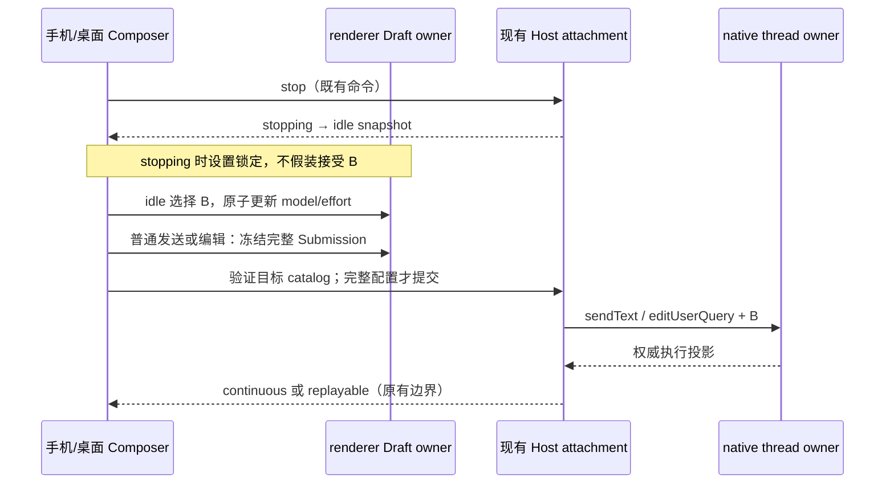

# 手机原生 Composer 与桌面一致性

## Feature Summary / Impact Brief

| 字段            | 决策                                                                                                   |
| --------------- | ------------------------------------------------------------------------------------------------------ |
| 开发意图        | 修复停止后手机切渠道/模型仍提交旧配置，以及编辑重发缺配置仍执行                                        |
| Capability / 层 | model-selection；option-source、draft-default、validation、commit-effect                               |
| 模式 / seeds    | implementation-handoff；SessionPane、ConversationComposer、useDraftConfigControl、useCodexModelCatalog |
| 范围外          | 提供方 429 重试策略、goal、账户额度、native runtime、relay、持久化格式                                 |

### 已确认缺陷与证据边界

手机 legacy toolbar 没有桌面 native 控件的 busy lock，而 SessionPane 会在
running/stopping 时忽略选择；异步 connection switch 也没有阻塞父级发送。
因此显示可点不等于新选择被接受。编辑路径原本允许空 Submission，native bridge
会沿用现有线程设置。日志只确认重试耗尽，没有请求 endpoint/model，不能证明事故
中具体哪一个时序被触发。修复确定的缺口，不推断新渠道返回了 429。

## UI Surface Matrix / Shared And Divergent Behavior

| 场景 / 入口                       | 共用实现与草稿 owner                                               | 默认 / 校验                              | 提交 / authority                                            | 平台边界                           |
| --------------------------------- | ------------------------------------------------------------------ | ---------------------------------------- | ----------------------------------------------------------- | ---------------------------------- |
| 停止后模型菜单 / Composer         | native catalog + CodexComposerModelControls；useDraftConfigControl | Host config/model/catalog；busy 禁止选择 | 点击同步写 renderer intent；Submission 才改变 native thread | 手机触控布局与桌面布局可不同       |
| 普通文本含“继续” / Composer       | createComposerSubmissionConfig；同一 draft                         | 目标目录验证完整 provider/model/effort   | sendText → 既有 Host → native thread                        | continuous / replayable 不合并     |
| 编辑重发 / SessionPane.handleEdit | 同一 draft 冻结函数                                                | 缺配置或目录未就绪不得 prepare/dispatch  | editUserQuery 携带完整 Submission                           | 保留既有 workspace rewind 平台能力 |
| legacy Codez 会话                 | 原 Selection View 与 connection switch                             | 原有 legacy 规则                         | 原 v4 runtime                                               | 不因 native 修复改写 legacy 语义   |

原生手机不再通过 legacy connection switch 改 native draft，不读取 legacy Selection
View，不改变全局连接方式；effort 使用 native 目录默认，与桌面一致。Host 探测
pending 时不启动 legacy prepare/prewarm，不允许普通发送或编辑重发。native 目录
loading/error 同样 fail closed，不拿旧模型当 fallback。
目录未就绪时 effective modelSelection 可为空；原始 Composer Draft intent 与正文
必须保留，恢复后再按目录解析为可提交配置，不能混淆 intent 与 effective selection。

## Feature Relationships / State Owners And Commit Sinks

| Rank           | 语义边                                   | owner / sink                      | 检查依据                             |
| -------------- | ---------------------------------------- | --------------------------------- | ------------------------------------ |
| must-inspect   | SessionPane → Composer → native controls | renderer draft 唯一意图 owner     | busy 控件与 callback guard 一致      |
| must-inspect   | 普通 send / edit → Submission            | native thread 执行 owner          | 完整配置；禁止 null dispatch         |
| should-inspect | catalog → default / readiness / prewarm  | 目标 Host；hook 为 scope 隔离缓存 | identity 与 remoteSessionId 贯穿     |
| conditional    | native queue 展示 / choice               | CLI CommandInbox admission        | 不向 native 暴露 legacy queue-resume |
| invariant-only | Host owner/lease 与 replay               | 既有 shared-host attachment       | 不创建第二份 Agent、queue、snapshot  |
| evidence-only  | QA fixture / loopback provider           | 合成 Host / pinned native         | 区分注入证据与实际请求               |

## Must-Preserve Invariants / Event Order

- model、effort、permission、Plan 只属于当前草稿；历史与在途请求不被菜单修改。
- running/prewarming/stopping/pending 输入时设置锁定；idle 选择 B 立即更新完整 draft。
- 异步附件/创建/prepare 前冻结；目录验证失败保留正文与选择，无命令副作用。
- identity key 为 `workspaceIdentity?.trim() || workspacePath`；scope 换代不沿用旧目录。
- 同一 Host runtime 执行命令；手机只改变投递恢复方式，不改变模型配置合同。

## Codegraph Evidence / Graph Delta

codegraph 尚未初始化；使用 bounded `rg` 与源码检查，不创建全仓索引。
深度 2：SessionPane → catalog/draft/Composer → controls/submission；bridge 已确认显式
modelSelection 会应用到 native turn，不新增协议。graph drift：conversation-model-control
seed 原来只描述 legacy toolbar，遗漏 native 控件。确认 delta：补 native seeds、
本文与 parity 不变量；检查 symbol 存在性、graph ID/edge 完整性。

## Planning Handoff / Clarification Log

用户要求修复并检查相关手机/桌面差异；沿用既有桌面 native 合同。原始“继续”
是普通消息，不是 goal resume。无未解决的产品选择。

### Domain Scope / Dimensions / High-Risk Cross-Products

纳入 conversation、native config 与 remote scope；优先 native × idle/stopping ×
selection/send/edit × catalog pending/ready/error。390px touch / 1200px desktop、
light/dark 为布局代表，scope 换代为隔离代表。
concept：Draft 是意图，catalog 是能力，snapshot 是运行事实，Submission 是冻结配置。

### Candidate Combinations / Accepted Cases

| ID      | Setup                                 | Action                    | Assertions                                     | 证据 / 状态                  |
| ------- | ------------------------------------- | ------------------------- | ---------------------------------------------- | ---------------------------- |
| MNCP-01 | native A；running/prewarming/stopping | 手机/桌面点 model、effort | 控件锁定，draft 仍 A；idle 解锁                | browser / planned            |
| MNCP-02 | native idle A；B 属于另一 provider    | 点 B 后立即输入“继续”发送 | B 与目录默认 effort；无 legacy 调用            | browser + loopback / planned |
| MNCP-03 | B 已选；原用户消息                    | 编辑重发                  | edit 带 B；缺 Submission 时不 prepare/dispatch | browser / planned            |
| MNCP-04 | Host pending 或目录 loading/error     | 发送/编辑；随后恢复       | 未就绪不提交，正文保留，恢复可发               | browser / planned            |
| MNCP-05 | 两个 workspace identity 或会话        | 选 B、切 scope            | 不复用另一个 scope 的目录/draft                | browser / planned            |
| MNCP-06 | native running queue                  | 展示队列、同配置跟进      | native 文案，无 legacy resume/choice 路径      | browser / planned            |

MNCP-07（accepted）：native 手机/桌面都不支持逐条反馈，不显示点赞/点踩；legacy
Web 保留反馈。native 行内编辑复用桌面 editor，固定 preserve files，不暴露 legacy
edit rewind 操作。独立文件撤销仍由既有能力投影与平台服务裁决，不经编辑绕过。
逐条反馈以 native Host 事实而非设备类型门控，pending/unavailable/unsupported
不传反馈 handler；不新增执行状态或服务。证据：browser + native loopback。

### Pruning Decisions / Questions For User

| 决策 | 剪枝                                     | 理由 / 代表                                  |
| ---- | ---------------------------------------- | -------------------------------------------- |
| P1   | 真实用完额度、所有 provider/429 次数叉乘 | 不改 retry；B payload 与 loopback 请求是边界 |
| P2   | goal、自动 compact、legacy 账户连接配置  | 用户普通文本；不同提交 owner                 |
| P3   | relay/owner lease 全套叉乘               | 无 transport 改动；保留隔离门禁              |
| P4   | permission×Plan×全部模型                 | 不改映射；覆盖默认 effort 与 busy 锁         |

无需用户补充选择。新场景保持 manual-review/pending，不自动晋升 CI。
fixture 只用 loopback/合成事实，不访问真实账号；以受控状态而非延时掩盖竞态。
catalog/matrix 链接此文，仅在通过后回填覆盖层级与 artifact。

原生回环候选 `native-model-switch.mjs` 可在隔离 Electron renderer 内只覆盖
SessionPane 的平台输入为手机（isDesktop=false、compactForRemoteControl=true），
其余产品源码、Host 与 pinned native 不替换。两个 loopback provider 分别记录请求，
验证 A 停止后普通“继续”和编辑重发都只请求 B。这证明手机 pane 的实际 native
提交链路，不证明手机浏览器/relay 的 replayable 网络传输。

## 实现与验证结果（2026-11-08）

模型目录、默认 effort、busy 锁、普通发送/编辑校验与 native 消息行门禁已统一，
不再按手机设备走 legacy 模型 connection switch、edit rewind 或逐条反馈入口。
上方表格是实现前计划，最新覆盖层级与未覆盖组合以
[coverage matrix](../docs/testing/conversation-session-e2e-coverage-matrix.md) 为准。
artifact：`packages/desktop/.e2e-artifacts/mncp-verification-DtJBfN`。
四组浏览器与手机/桌面原生回环通过；既有冻结 6、native Node 21、手机传输 232 项通过。
真实手机 relay UI 与 Highspeed 缺配置编辑组合未单独验收，不自动提升新候选。
功能图新增 seeds 均存在且没有新增悬空边；基线已有 4 条悬空边未扩大到本次修改。
