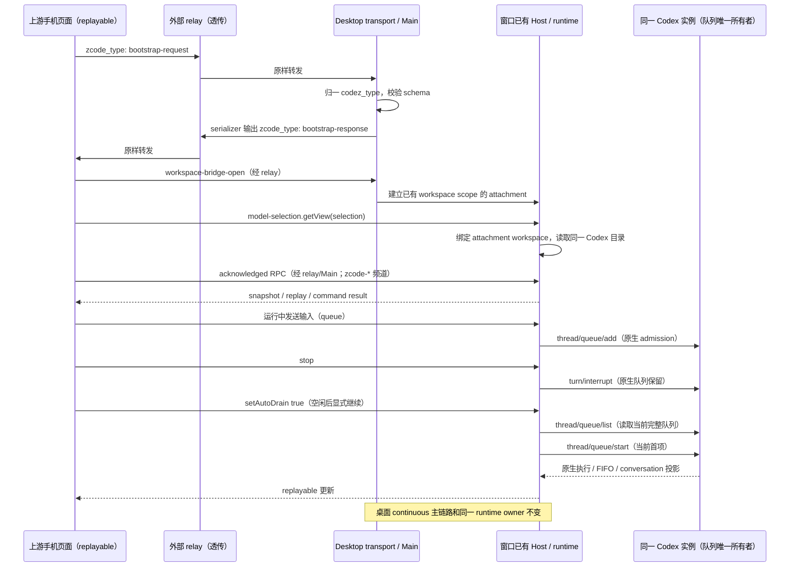

# 手机远控与上游托管页面的协议兼容

> 历史协议兼容记录：新版桌面手机远控要求端到端加密，不能再用原样上游托管页面
> 完成业务连接。当前产品合同见
> [手机远控端到端加密](../docs/web-remote-control/end-to-end-encryption.md)。

## 问题与产品规则

2026-10-11 导出的日志显示 desktop device 已进入 `paired`，随后带 bootstrap
requestId 的业务载荷被判为 invalid 并丢弃，手机最终提示 desktop bootstrap timeout。
当前 fork 将上游的 `zcode_type` 改成了 `codez_type`。
配对成功不意味着业务协议兼容；协议字段不能随产品品牌重命名。

通过 Codez Android App 扫码访问可信加密手机页面（或兼容上游协议），在完成智谱 OAuth 登录与 E2EE 双向握手后，应能读取桌面窗口的工作区与任务，建立 workspace bridge，
使用同一个 Host/runtime 读取会话和发送输入，并在断线后恢复。Codez 品牌、数据目录、
Codex 后端和桌面本地 IPC 名称保持不变。

## 协议边界与唯一所有者

- shared 提供无状态的 relay payload 边界转换。业务代码继续使用 `codez_type`；
  WebSocket 出站仅发送上游的 `zcode_type`。入站接受上游字段或已有 fork 字段，
  拒绝同时提供两个字段的歧义载荷，再应用既有 schema 校验。
- client 的既有 serializer 是最终 JSON 和字节计量的唯一生成路径，转换发生在缓存
  final JSON 前；measure、首次发送和 replay 使用完全相同的 JSON。
- desktop/web transport 在 raw RPC 路由前归一字段，不绕过 strict schema、大小、
  CRC、分片、bridge identity/generation/recovery、ACK 或 stale-result 检查。
- RPC 内部及已发布 fork 的 task/agent/session 频道保留 `codez-*`；
  ServiceCollection 在现有暴露路径额外注册三个明确的上游 `zcode-*` 别名。
  两个名称引用同一个已选定的 connection-scoped override/channel，不新增服务、
  attachment、订阅所有者或第二套命令写入路径。
- 手机 replayable ChannelServer 的嵌套 Uint8Array 出站标记使用上游的
  `__zcode_rpc_nested_uint8array_v1`；其他 RPC 连接保留 fork 出站标记，避免破坏
  已发布远端的归档/附件传输。解码同时兼容两个标记，保留严格两字段 envelope 检查。
- workspace、会话、队列和命令 admission 仍由既有 Host/runtime 所有；
  Main、relay 和字段转换不保存业务状态。
- 上游手机页面的 `model-selection.getView` 不传 fork 新增的 workspace 参数。
  手机 attachment 从既有 bridge 目标绑定 workspacePath/identity，在 Host 的现有
  IModelSelectionService 调用前补齐上下文；明确的其他 workspace 请求拒绝，
  变更事件按 identity（本地 path fallback）过滤。无新 catalog、缓存或配置写入口。
  Desktop continuous 及无上下文的基础服务行为不变。local attachment 可携带
  可选 workspacePath/identity，但仍指向同一个 window-scoped Local Host；
  remote attachment 继续使用已有 remoteSessionId/identity。

## 验收与回归

1. 上游 `zcode_type` 的 bootstrap/view-state 请求可解析，响应仅含上游字段；
   内部 payload 不被修改，已有 `codez_type` 入站继续可用。
2. 缺失字段、错误类型、双字段载荷、非法 RPC/ACK、额外 raw RPC 字段继续被拒绝。
3. 上游 raw RPC 分片和 ACK 在 desktop/web transport 都进入既有 raw 路由；
   不被静默吞掉或转入不带 ACK 的旧路径。
4. final JSON 字节数、1MiB 硬边界和 replay JSON 一致性保持。
   bootstrap / workspace-list 等单帧 app payload 的内容侧预算与裁剪规则见
   [手机远控 app payload 字节预算](../docs/web-remote-control/app-payload-budget.md)。
5. 上游和已发布 fork 的 task/agent/session 频道都可访问同一个 connection override；
   主 collection 不变，嵌套二进制可双向解码。
6. 本地 WebSocket 集成覆盖配对、bootstrap、workspace bridge、真实 RPC 读写，
   并覆盖重新连接后的 bootstrap。不向真实 relay 注册测试设备，不操作真实用户任务。
7. 执行目标回归、typecheck、lint、架构与格式检查。自动化协议验证不替代用户
   macOS 发布包与真实手机的最终扫码验证；未验证部分须明确报告。
8. 未改动的上游手机页面显示真实 Codex 模型，创建任务并发送到实际 Codex bridge，
   看到回复后刷新恢复同一个任务，继续发送；重连不重复首条输入。
9. 运行中输入进入同一 runtime 队列；停止保留已接受的队列，显式继续后完成该输入。
   测试模型的回复屏障只控制测试时序，不进入生产链路。

## Codex 原生队列边界

上游手机“继续”发出 `setAutoDrain { autoDrain: true }`；Codex 不提供持久的
Codez auto-drain policy。只在会话空闲时将该操作映射为读取原生完整队列，
随后 `thread/queue/start` 启动当前首项，并刷新原生队列。后续执行由 Codex 自身负责，
不另建 drain loop 或 shadow queue，不通过 `turn/start` 重发文本。
空队列不启动任何 turn；busy 或 `autoDrain: false` 明确拒绝，不伪造原生策略。
操作仍经过既有 commandId ledger、revision/epoch 和 writer guard；重复 commandId
不得派发下一项。Desktop 原生 queue 展示及 `autoDrain: false` 投影不变。
