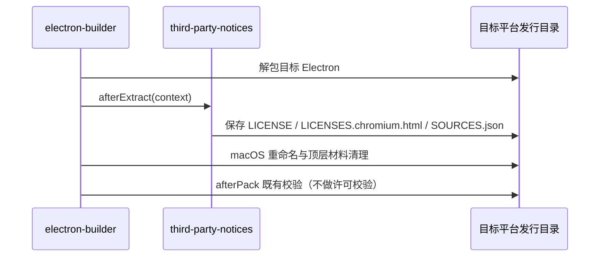

# 第三方许可材料与发行交付

## 产品规则与所有者

第三方复制内容保留各自许可、版权及适用的文件内修改声明。包元数据不能单独替代上游原始材料。没有取得证据的事项保持阻断，不能通过更新哈希、删除记录或编造权利人关闭。第一方代码的对外许可由开源导出覆盖层提供，不在本目录声明。

| 所有者                                                                                                                               | 职责                                                             |
| ------------------------------------------------------------------------------------------------------------------------------------ | ---------------------------------------------------------------- |
| `third-party/*.json`、`third-party/upstream/`、`third-party/native-search/`、`third-party/runtime/`、`third-party/review-blocked.md` | 材料与待核验事项的唯一登记入口、原文快照与保持阻断的缺口台账     |
| `scripts/third-party-npm.mjs`                                                                                                        | 解析锁文件生产图与实际安装图、读取包内原文                       |
| `scripts/generate-third-party-notices.mjs`（`licenses.mjs notices`）                                                                 | 生成 `THIRD-PARTY-NOTICES.md` 与 `inventory.json`                |
| `scripts/licenses.mjs check [--strict]`                                                                                              | 显式许可标识、新鲜度与材料完整性检查                             |
| `scripts/third-party-notices.mjs`                                                                                                    | 构建期读取与分发声明；各构建入口只调用这一模块，不另建许可数据库 |

## npm 生产图的范围

- 生产图取所有工作区项目的生产依赖，包括不发布的内部应用；内部应用的构建工具（如 Vite 插件）必须放在 `devDependencies`，否则会把构建工具误算为生产依赖。
- 只登记 pnpm 在当前宿主上会安装的包：锁文件 `packages` 段的 `os`/`cpu`/`libc` 约束与 `pnpm-workspace.yaml` 的 `supportedArchitectures`（`current` 取宿主值）按 pnpm 的可安装规则比对。不可安装的平台包及只经由它们引入的依赖不安装、不分发，不进生产图，也不作为缺失安装报错；不再维护按包名的例外名单。
- pnpm 只在 Linux 宿主上检查 `libc`，因此在 macOS / Windows 上生成的声明包含 glibc 与 musl 两类 Linux 平台包，是最全的集合；正式生成声明在 macOS 上执行。
- 非宽松许可的生产依赖只按包名逐项登记人工复核结论，登记同时绑定许可类别，许可变化后重新阻断：
  - LGPL：只允许以独立、可替换的动态库形式分发的 libvips（sharp 的 `@img/sharp-libvips-*` 与内含 libvips DLL 的 `@img/sharp-win32-*`，只由真实 Computer Use 包引入），声明中附原文。
  - 内部应用独有且不随产品分发的依赖（当前为 `apps/dev-docs` 的 `elkjs`，按 EPL-2.0 使用）。
  - 其余 LGPL/GPL/EPL 等仍按类别阻断。
- 开源导出树的工作区与锁文件不同于闭源，其声明与 inventory 由导出流程在开源依赖树上重新生成，不沿用闭源声明。

### Codez 开源 CUA producer

自研 `packages/codez-cua` 的生产图包含 xa11y、nut-tree-fork 及其可安装的平台包；
与其他工作区使用同一个锁定生产图、包内原文与声明生成入口，不维护另一份 CUA 许可数据库。
最终安装后再按实际解析版本生成 notices / inventory，不能从 manifest 的 caret 范围推断版本。

xa11y 0.15.0 的 npm 主包缺少完整 LICENSE，但其 npm gitHead 与 CI pinned addon source
一致（`a3badccf5761615ea3412ee55c19ac3764e27913`），该固定源码的完整 MIT LICENSE
可作为版本绑定的补充原文。补录保留原版权行、固定来源与 SHA，不用标准许可模板、
author 推断或 acceptedMissingNotice 关闭缺口。平台包也只在核对其实际原文缺口后逐包补录。
nut-tree-fork 的许可材料从实际安装包读取；声明标识不能替代包内 LICENSE/NOTICE。
Windows/Linux 自编译 addon 的固定 source / patch provenance 与包版本保持一致，
不把 npm inventory 当作整个 Rust/native 依赖树的全平台 SBOM。

六个 `@crowecawcaw/xa11y-*@0.15.0` 平台包的固定版本元数据没有各自的 npm gitHead，
不声称它们有；绑定依据是主包 gitHead `a3badccf…` 的 `xa11y-js/package.json`
（`napi.binaryName: xa11y` + 六个 napi target 恰好展开成这六个包名，version / license /
repository 与各平台归档自带 manifest 一致）、六个归档 `dist.shasum` 复核，
以及它们与主包在同一次 napi pre-publish（2026-09-19T03:45:31Z–03:46:23Z）内发布。
LICENSE blob 在 `a3badccf…` 与 release tag `v0.15.0`（`3b88c4f5…`）逐字节相同，六个平台包共用该快照。

`@nut-tree-fork/{shared,provider-interfaces,default-clipboard-provider,libnut}@4.2.6`
的实装目录与官方归档都只有 package.json / README / CHANGELOG / dist，没有任何许可文件，
`license: Apache-2.0` 标识不能替代原文。发布仓库是 `github.com/ZachJW34/nut.js`
（根 manifest `@nut-tree-fork/monorepo` 4.2.6；GitHub 上不存在 `nut-tree-fork` org），
tag `v4.2.6` = `0bcbcdc6d080c0fe007b8000a3915d4461a7685d` 处四个包的 manifest
（name / version / license / main / description）与各自归档一致，全树只有
`core/nut.js/LICENSE` 一份许可文件，且与实装 `@nut-tree-fork/nut-js@4.2.6` 与
`@nut-tree-fork/libnut-linux@2.7.5` 包内 LICENSE 逐字节相同
（`c71d239df91726fc519c6eb72d318ec65820627232b2f796219e87dcf35d0ab4`）。
因此补录用该发布自身的原文，不用 apache.org canonical 文本替代；
该原文保留 Apache-2.0 附录样板 `Copyright [yyyy] [name of copyright owner]`，不填写、不推断权利人。
`readable-web-to-node-stream@3.0.4` 上游任何 revision 都没有独立许可文件，
采用其归档内 README `## Licence` 段的完整 MIT 原文（含发布方自己的
`Copyright (c) 2019 Borewit` 版权行），快照保留归档发布时的 CRLF 字节。

`buffer-equal@0.0.1`（经 jimp → load-bmfont 进入生产图）与 `tr46@0.0.3`
（经 node-fetch / isomorphic-fetch → whatwg-url@5 进入生产图）仍阻断：
两者的版本对应 revision（`inspect-js/buffer-equal` tag `v0.0.1`、`jsdom/tr46` tag `0.0.3`
= npm gitHead `a8009f9c…`）全树都没有任何许可原文，归档内也没有；
发布方是在之后的 revision 才补 LICENSE，且都不是该版本的 gitHead。
不用晚于版本的文本或标准模板冒充版本绑定原文，缺口、已尝试的来源与关闭条件记录在
`third-party/review-blocked.md`；在这两项关闭前
`licenses.mjs notices` 会失败，声明与 inventory 不重生成。

## 开发、构建与校验边界

```text
开发 / bootstrap / build → readThirdPartyNotices 等读取已有材料 → 复制或嵌入产物
显式 notices / check     → 核验输入与原文 → 更新清单或报告失败
```

- 构建不更新清单，也不隐式运行许可校验；inventory 过期、待核验项或原生登记不匹配都不阻断开发和打包。
- 声明文件和所需材料仍是打包输入；缺失、无法读取或无法解析时保留原始错误，不生成空声明。
- 原生材料只在显式生成时 `{ verify: true }` 核验输入和原文。
- `readVerifiedNotices(root, { requireComplete: true })` 目前只由显式检查使用；接入 SEA 发布与 SMB 上传前，必须先按本仓库依赖树重新生成声明并关闭已登记缺口，否则两条发布路径会立即失败。

## 交付入口（本仓库已接入）

| 产物                        | 位置                                                                                                                          | 接入点                                                             |
| --------------------------- | ----------------------------------------------------------------------------------------------------------------------------- | ------------------------------------------------------------------ |
| Desktop                     | `Resources/THIRD-PARTY-NOTICES.md`、`Resources/licenses/electron/`                                                            | `electron-builder.config.js` 的 `extraResources` 与 `afterExtract` |
| Web                         | 部署根目录 `THIRD-PARTY-NOTICES.md`，HTML `rel="license"`                                                                     | `packages/web/vite.config.ts` 的 `thirdPartyNoticesVitePlugin`     |
| Server HTTP / remote bundle | `packages/server/dist/`、`dist/remote/`                                                                                       | `tsup.config.ts` 的 `onSuccess`、`build-remote.ts`                 |
| CLI                         | `apps/codez-cli/packages/cli/dist/THIRD-PARTY-NOTICES.md`                                                                     | `scripts/build.mjs`                                                |
| 搜索工具                    | 每个工具目录的 `THIRD-PARTY-NOTICES.txt`、`SOURCES.json`；SEA 内嵌同名资产                                                    | `prepare-native-search-tools.mjs`、`sea-runtime-tool-assets.mjs`   |
| 远端组件                    | `server/`、`node-pty/<platform>/`、`glm/<platform>/` 的声明，`node/<platform>/LICENSE.node.txt`                               | `prepare-prebuilds.mjs`，在组件哈希计算前复制                      |
| 独立 Server 发行包          | `runtime/THIRD-PARTY-NOTICES.md`、`LICENSE.node.txt`、`NODE-SOURCES.json`、`licenses/{agent,official-plugins}/`、工具目录声明 | `stageCli.ts` 读取后显式传入 `stage.ts`                            |
| 统一分发包                  | `agent/THIRD-PARTY-NOTICES.md`                                                                                                | `scripts/build-codez.mjs`                                          |

未接入：`codez --licenses` 入口与 SEA 内嵌 Node 许可（SEA 基底 Node 版本随构建机浮动，`runtime/sources.json` 只登记固定版本）；producer 归档内嵌声明（会改变已固定 SHA-256 的归档字节）。

## Electron 事件顺序



材料从实际目标归档读取，不从宿主 Electron 替代。重复 staging 覆盖同一目标目录；不同目标使用各自 appOutDir。Windows 重命名后的 `LICENSE.electron.txt` 也可读取。

## 验收

1. `node --test scripts/third-party-notices.test.mjs`：缺少 inventory 或哈希过期时构建复制仍成功，显式校验失败；严格校验拒绝待核验项；缺少声明时保留 ENOENT。
2. 独立 Server staging 的组件归档分别包含 npm、Node 与搜索工具声明，工具声明缺失时 staging 失败。
3. 执行 `node scripts/licenses.mjs check`，如实记录在当前依赖树上的结果；不以更新哈希代替重新生成与审核。
4. 最终安装包未实际构建时，不声称完成全平台安装包审计。
